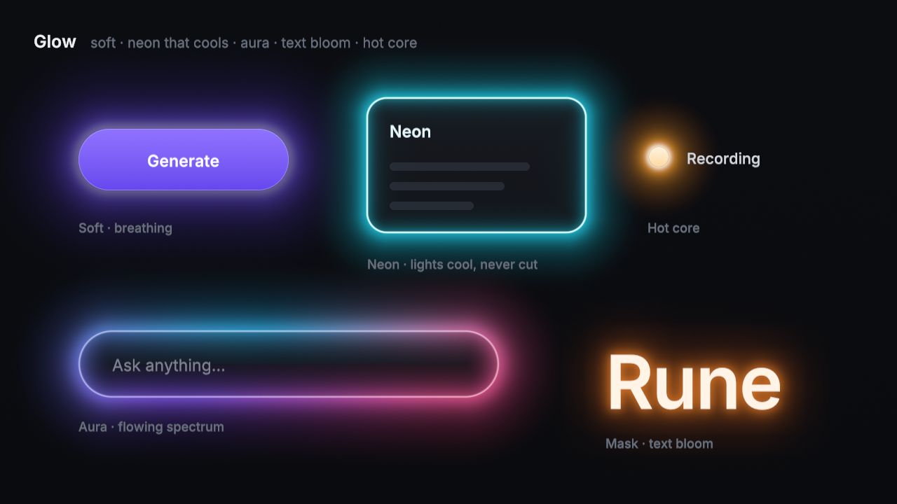
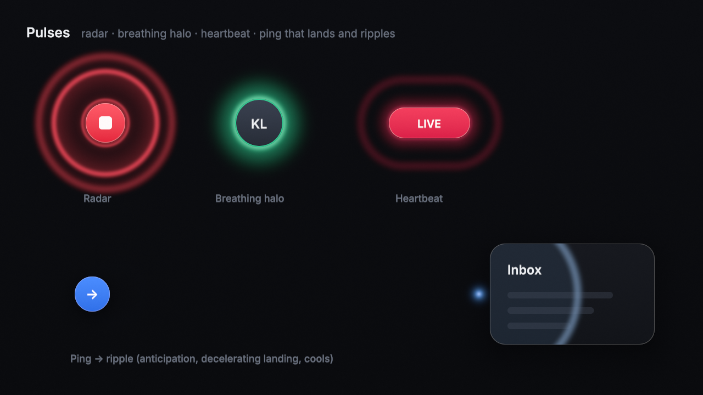
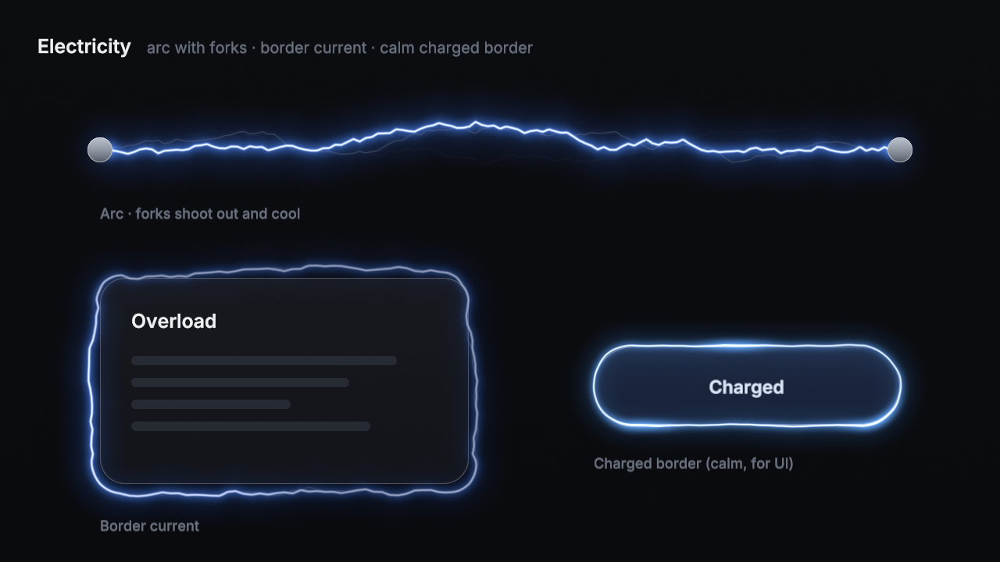
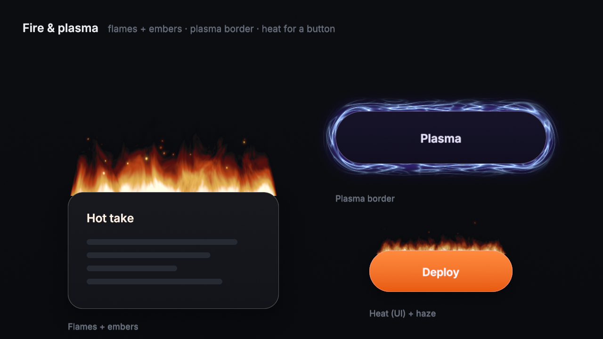
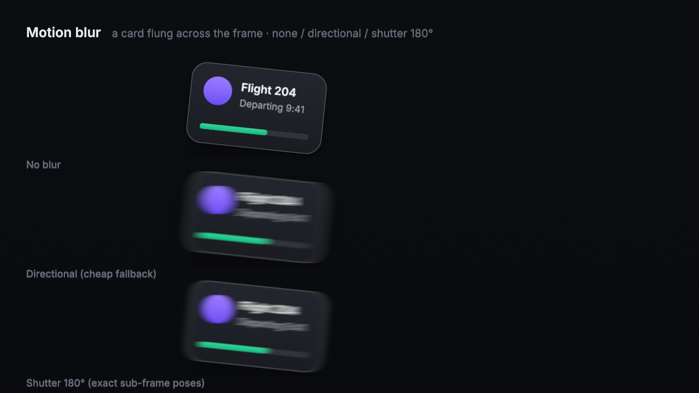
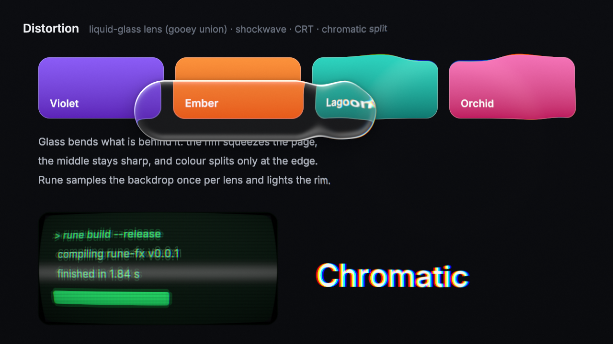
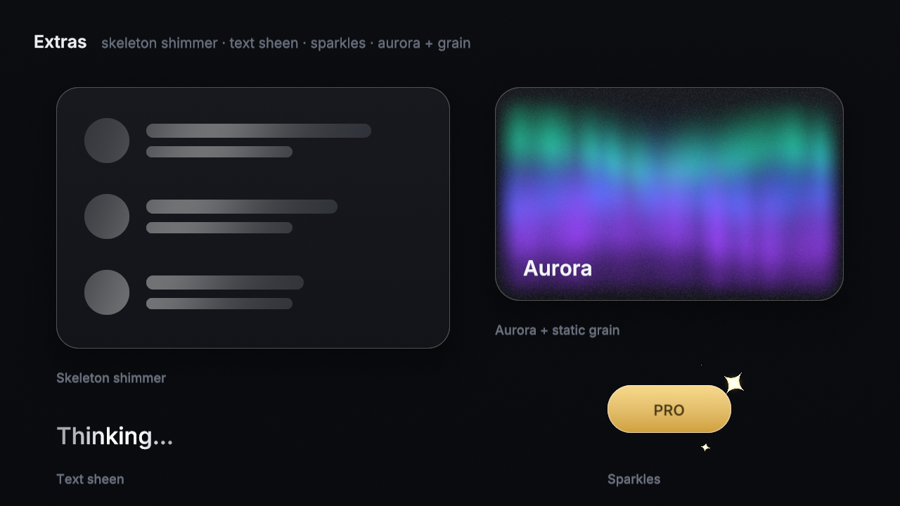

# rune-fx

Effect layers for Rune: glow, pulses, electricity, fire, motion blur, distortion, and some extras
(shimmer, sparkles, aurora, grain). Each effect is a WGSL fragment shader on an instanced quad with
typed params. Given (time, seed), every frame is deterministic. A layer whose intensity is 0, whose
one-shot has finished, or that is off screen is never drawn.

Build and run through HiveMind from the workspace root:

```sh
hivemind run --kind cargo -- cargo run --release -p rune-fx --example gallery   # stills, strips, timings
hivemind run --kind cargo -- cargo test --release -p rune-fx --lib              # contract tests
```

Output lands in `demo/fx/` (repo root): `<effect>.png`, `<effect>-strip.png` (8 frames),
`<effect>-reduced.png` (reduced motion), `<effect>.mp4`, `motion-quarter-speed.mp4`, `timings.md`.
`gallery --frames DIR --fps 60 --seconds 2 --effect fire [--start 0] [--reduced]` dumps a PNG sequence.

| | |
|---|---|
|  |  |
|  |  |
|  |  |
|  | |

## API

```rust
use rune_fx::*;

let card = Shape::rounded(262.0, 70.0, 156.0, 96.0, 14.0); // points
let layers = [
    Fx::glow(GlowParams { style: GlowStyle::Neon, color: rgb(0x22d3ee), heat: heat.at(t), ..Default::default() })
        .on(card).over().at(t),
    Fx::electric(ElectricParams::charged()).on(Shape::capsule(380.0, 222.0, 196.0, 50.0)).seed(3).at(t),
    Fx::lens(LensParams { second: Some(Shape::circle(lx, 116.0, 30.0)), ..Default::default() })
        .on(Shape::capsule(140.0, 84.0, 200.0, 64.0)).at(t),
];

let mut fx = FxRenderer::new(&device, target_format, FxOptions { dither: target_is_8_bit });
let stats = fx.prepare(&device, &queue, &FxFrame {
    viewport: [w, h], scale: 2.0, layers: &layers,
    backdrop: Some(&backdrop_view),        // only distortion reads it
    sources: &[&mask_pyramid.view, &node_layer_view],
});
// in the node's render pass, around the node itself:
fx.draw_layer(&mut pass, 0);              // or fx.draw_all(&mut pass, &layers, Some(Place::Under))
```

`FxLayer` builders: `.at(time)`, `.seed(n)`, `.over()` / `.under()`, `.reduced(bool)`,
`.source(slot, rect)`. `layer.is_animating()` tells the frame loop whether to keep ticking.
`Fx::cost()` returns the static cost declaration. `FxStats` reports draws, idle and off-screen
culls, covered pixels, and whether any drawn layer needs a backdrop.

Time helpers:
- `Phase` keeps an effect's phase continuous when you animate its speed: `set_speed(t, s)`
  adjusts an offset so `at(t)` never jumps.
- `Heat` gives a light with attack and exponential cooling. Feed it to `GlowParams::heat` and the
  glow shrinks, deepens and dims instead of cutting off (see the neon card in `glow-strip.png`).
- `MotionSamples::from_track(params, rest_rect, t, scale, |t| Pose)` samples the analytic track
  inside the shutter interval.

## Integration contract (for the Rune renderer)

**Inputs per layer**
- Node shape in points: a rounded rect, capsule or circle (`Shape`), or a mask texture plus the
  rect it covers (`Source`).
- Time from Rune's clock, so slow-mo, pause and stepping work and goldens stay deterministic. One-shots
  (ping, ripple, shockwave) take a `t0` on the same clock.
- Seed.
- Params.
- `reduced_motion`.
- Optional:
  - an analytic track (motion blur);
  - the backdrop texture (distortion: a copy of the target taken right before the layer, which
    must not be the render target);
  - a source texture (mask glow and mask shimmer use a `MaskPyramid`; motion blur uses the node
    rendered at rest with at least 2 px of transparent margin).

**Output**
- A premultiplied, linear-light colour layer, drawn with `PREMULTIPLIED_ALPHA_BLENDING` over or
  under the node (`Place`).
- Light effects (glow, pulses, electricity, fire) write `rgb > a`, so they add light like a screen
  blend on dark UI. `occlusion` controls how much they also cover what's behind.
- Distortion and motion blur write replacement pixels with `a = 1` inside their mask.

**Cost and culling**
- `prepare` does all culling: idle layers (intensity 0, a fully cooled glow, a one-shot outside its
  window) and layers whose bounds miss the viewport get no instance, no CPU tables and no draw.
- Motion blur at rest has `count == 1`. The renderer should then skip the layer
  (`!samples.is_moving()`) and draw the node normally.
- Each layer is one quad clipped to its bounds, in one pass.
- Distortion adds the backdrop copy: scissor it to the union of the distortion bounds.
- Mask glow adds a mip build once per mask change (6 small passes).

**Per-frame CPU tables**
- Anything that is a 1D function of (time, seed), or a particle list, is evaluated once per frame
  into the `data` storage buffer instead of once per pixel: bolt paths and their blurred halo paths,
  energy crawl, forks, embers, sparkles, aurora curtains, and motion poses.
- They use the same integer hash as the shaders, so there is no `sin`-hash and results don't vary
  by GPU.
- This cut electricity from 9.6 ms to about 0.5–1 ms for a full 1200×800 px quad.

**Reduced motion**
- Every effect has a calm fallback with no travel:
  - Looping noise effects (electricity, fire, haze, aurora) freeze on a fixed, pleasant pose.
    Forks, embers and flicker stop.
  - Radar becomes a static halo, breathing holds still, and heartbeat holds a steady glow.
  - Ping fades its destination in and out without travelling. Ripple and shockwave become a short,
    soft brightening.
  - Shimmer becomes a gentle opacity breath. Motion blur turns off.
  - Glow cooling stays, because it's a fade, not travel.
- See `<effect>-reduced.png`.

**Quality**
- Dither:
  - The gallery renders into Rgba16Float and dithers once at the resolve (TPDF, ±1 LSB, static per
    pixel, so there's no temporal shimmer).
  - For 8-bit targets, set `FxOptions::dither` and each effect dithers its own output in sRGB
    space, gated to where there is signal.
- Edges:
  - Every light falls off analytically and is windowed inside its bounds, so no quad edge ever
    shows.
  - Overlays (aurora, grain, shimmer) feather inside the node shape.
  - Glass and the CRT anti-alias their edges at 1 px.

## Effects and params

Lengths are in points, times in seconds.

| Effect | Variants | Key params (default) | Notes |
|---|---|---|---|
| **Glow** `GlowParams` | `Soft`, `Neon` (white-hot hairline rim, bloom both sides), `Aura` (3-colour spectrum flowing round the perimeter, inner rim light), `Mask` (text/icon bloom from a `MaskPyramid`) | radius 14, intensity 1, inner 0, occlusion .15, breathe 0, breathe_period 2.6, heat 1, hot .6, aura_speed .12, rim_width .6, reach 4.5 | Bloom = erf edge + inverse-square tail, windowed. `heat` cools the light. Mask glow samples fractional mip levels with tent taps, so an animated radius never steps |
| **Pulse** `PulseParams` | `Radar`, `Breathe`, `Heartbeat`, `Ping{from,dir,travel}`, `Ripple{at}` | count 3, period 2.4, reach 36, width 1.6, t0, duration .75, repeat 0, lag .16, head_radius 2.6 | Rings follow the shape's SDF. The ping winds up against its travel (Bézier P1 = −0.12), shoots, decelerates to zero velocity, then blooms and cools. Ripple `reach: 0` = auto (farthest corner) |
| **Electric** `ElectricParams` | `Arc{a,b}`, `Border`, `Charged` (`ElectricParams::charged()`) | amplitude 5, frequency 2.4 cells/100pt, speed 3.2, core_width .6, glow 5, forks .55, flicker .45, strands 2, gap 2, fork_len 20 | Paths are noise-displaced polylines from CPU tables. The halo follows a Gaussian-blurred copy of the path. Forks grow out with a decelerating front (50 ms), then fade from white to the tint to violet |
| **Fire** `FireParams` | `Top`, `Border`, `Heat` (`FireParams::heat()`), `Embers`; `FireParams::plasma()` | height 54, scale 20, speed 1.5, embers 16, ember_rise 58, ember_size .8, ember_life 1.5, warp 1, sides .32, base_glow .5, swirl 0 | Domain-warped fbm (2+2+4 octaves) scrolling upward through a 3-colour ramp. Embers are CPU particles drawn as short shutter streaks that cool white → orange → red |
| **Motion blur** `MotionBlurParams` + `MotionSamples` | `Shutter` (exact sub-frame poses), `Directional` (taps along the velocity) | shutter_angle 180, frame_dt 1/60, max_samples 48, px_per_sample 1.25, smooth_shutter true | Sample count = travel px / 1.25, so it's 1 at rest. Raised-cosine shutter weights give soft trail ends. Poses include rotation, scale and opacity |
| **Distort** `DistortParams` | `HeatHaze`, `Shockwave`, `Lens(LensParams)`, `Crt`, `ChromaSplit` | lens: bevel 14, depth 16, dispersion .14, magnification 1.04, presence 1, frost 0, shadow .35, rim 1.6, union_k 22, morph 0, `second: Option<Shape>` | Lens uses psychopomp's thin-surface optics: a superellipse bevel (power 3) bends light by `tan(θ − asin(sin θ / 1.5))`. Per-channel spread splits colour at the rim, a soft blur covers the squeezed rim, and it adds sky fresnel, a specular line on the lit arc, a counter-line and a drop shadow. `presence` ramps lensing, rim and shadow together, so the glass appears by lensing, not by fading. A second shape smooth-unions into a gooey merge; `morph` lerps toward it |
| **Shimmer** `ShimmerParams` | shape or mask (`use_mask`) | period 1.8, band 28, angle .35 rad, intensity .16, pause .3 | Skeleton loaders and "Thinking…" text sheen. The band starts and ends off the shape, so it never cuts |
| **Sparkles** `SparkleParams` | – | count 9, life 1.5, size 7, margin 10 | 4-point glints with a `sin³` envelope |
| **Aurora** `AuroraParams` | – | scale 120, speed .25, intensity .5, feather 40 | 3 curtains from CPU tables, plus noise rays |
| **Grain** `GrainParams` | static or animated (`fps`) | amount .03, fps 0 | Static by default (no temporal shimmer) |

## Costs

From `demo/fx/timings.md`: Apple M2 Max (Pro, shared with other jobs). One layer covers a
600×400 pt region at 2× (1200×800 = 960k px, smaller where noted). GPU time per draw is the median
over 10 draws per timestamped pass. "reads" = texture taps plus CPU-table reads per pixel; "noise" =
gradient-noise evaluations per pixel.

| effect | px | reads | noise | backdrop | ms |
|---|---:|---:|---:|:-:|---:|
| glow soft / neon | 960k | 0 | 0 | | 0.27 / 0.31 |
| glow aura | 960k | 0 | 1 | | 0.65 |
| glow mask (text) | 960k | 13 | 0 | | 0.36 |
| pulse radar / breathe / heartbeat | 960k | 0 | 0 | | 0.57 / 0.21 / 0.26 |
| pulse ripple | 544k | 0 | 0 | | 0.12 |
| electric arc (3 strands) / border / charged | 960k | 37 / 43 / 37 | 0 | | 0.81 / 0.61 / 0.58 |
| fire top + 16 embers / plasma border / heat | 667k / 960k / 667k | 32 / 0 / 6 | 8 | | 1.73 / 1.59 / 1.16 |
| distort heat haze | 960k | 1 | 6 | yes | 1.35 |
| distort shockwave / CRT / chroma split | 960k | 3 / 7 / 3 | 0 | yes | 0.13 / 0.38 / 0.53 |
| distort lens / lens + frost | 960k | 12 | 0 | yes | 0.31 / 0.53 |
| shimmer / grain | 960k | 0 | 0 | | 0.48 / 0.68 |
| sparkles ×9 / aurora | 960k | 18 / 12 | 0 / 3 | | 1.23 / 1.64 |
| motion shutter (48 poses) / directional (32 taps) | 467k | 48 / 32 | 0 | | 1.61 / 1.54 |

These are worst-case full-region numbers. Real layers hug their node: the gallery's 224 pt card
with flames and embers covers about 195k px (about 0.5 ms), and a charged 196×50 button border
about 115k px (about 0.05 ms).
Timings on the shared Pro varied by about 1.5–3× between runs (cheap effects like grain and chroma split
measured 0.1–0.2 ms in a quieter run), so read them as relative costs. A reserved machine is needed
for gating.

## Gaps and next steps

- **Glow from mask** needs the caller to render the mask into `MaskPyramid::levels[0]` and call
  `build_mips`. Rune should cache the pyramid per text run.
- **Backdrop** is one texture for the whole frame. Overlapping distortions need a fresh copy between
  them (the gallery does this). A real compositor should copy only the scissored union rect.
- **Motion blur** composites a cached node layer. Rune needs to render the moving subtree into that
  layer, and should skip the effect at rest.
- **Fire** is the heaviest per pixel (8 noise evaluations). Half-resolution evaluation with a
  bilateral upsample would cut it about 3×. Not done.
- Electricity forks grow and cool but don't sub-branch.
- Blur and frost in the lens use an 8-tap spiral, not the Jimenez pyramid from research note 12.
- Bind groups are rebuilt every `prepare`. They should be cached per (backdrop, source) pair.
- No CPU reference renderer or golden tests for the shaders yet; the CPU-table and contract tests
  live in `src/lib.rs`.
