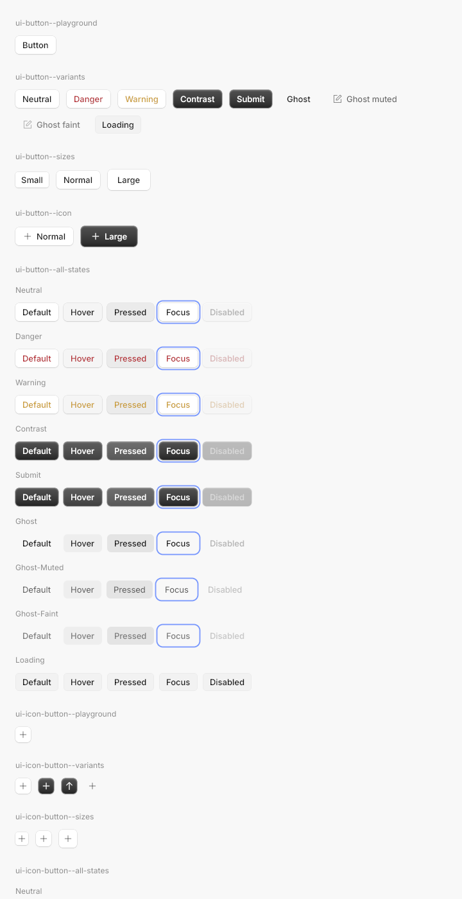
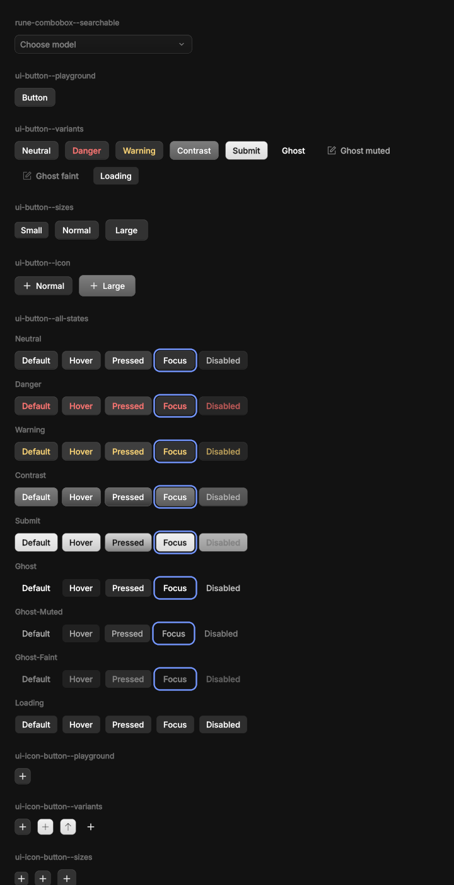

# rune-kit

Generic, themable components for Rune, with the names, variants, sizes and states of
`@opencode/ui`, so screens port from the Solid app by name. Components read only semantic
tokens from a `Kit`; a theme supplies them. Nothing here is OpenCode-specific.

 

## The split (PLAN.md §7)

| Crate | Holds | Knows about OpenCode? |
|---|---|---|
| `crates/rune` | Elements, layout, renderer, `Theme::from_json` (themes as data). Gained only generic primitives for this: CSS box shadows (offset, spread, inset), vertical gradients, outlines, `El::anchored` overlays, a few layout helpers. | No |
| `crates/rune-kit` | The token schema (`Kit`: `Palette`, `Elevation`, `Type`, `Radius`, `Motion`, `Glyphs`), the components, a box-shadow parser for web theme data, and `Kit::neutral`, a plain theme from `rune::tok`. | No |
| `themes/opencode` (`rune-theme-opencode`) | OpenCode's theme as data (`assets/theme.json`: every `@opencode/ui` token as the browser resolves it, both appearances, computed shadows), its fonts, its icon catalog subset, and the mapping onto `Kit`. | Yes, and only here |
| `examples/kit-gallery` | One scene per Storybook story, by story id. `--kit neutral` renders the same stories on the neutral theme. | Uses the theme |

Why the token schema lives in the kit, not the core: the core already has themes as data
(`rune::Theme`, any named tokens). The kit is the layer that decides which semantic roles
components need (button elevation, overlay hover, depth sheen, …); a theme crate fills them.
Another brand writes another theme crate; no component changes.

## Use

```rust
let k = rune_theme_opencode::kit(cx.system_dark());
let mut layer = Vec::new();          // overlay contents, mounted above everything
let body = col()
    .child(Button::new("Save").variant(ButtonVariant::Contrast).on_press(|s: &mut App| s.save()).build(k))
    .child(Switch::new(s.sync).label("Sync").on_toggle(|s: &mut App| s.sync = !s.sync).build(k))
    .child(
        Select::new("model", &MODELS)
            .current(Some(&s.model))
            .open(s.open == Some("model"))
            .on_toggle(|s: &mut App| s.toggle("model"))
            .on_close(|s: &mut App| s.open = None)
            .on_choose(|s: &mut App, v: &str, _: &mut Tx| s.model = v.into())
            .build(k, &mut layer),
    );
rune_kit::root(body, layer)          // the view's root
```

`AppSpec { fonts: rune_theme_opencode::FONTS, families: rune_theme_opencode::FAMILIES, .. }`
loads Inter and IBM Plex Mono.

For a small app theme, derive the semantic colours from three opaque tokens:

```rust
let t = rune::Theme::from_json(THEME, dark)?;
let mut k = rune_kit::Kit::from_palette(rune_kit::PaletteSeed {
    bg: t.color("bg"),
    fg: t.color("text"),
    accent: t.color("accent"),
});
k.radius.sm = 3.0;
```

Layers step OKLab lightness away from `bg`; borders, hover and press are `fg` at low alpha,
solved over `bg` (`k.blend_over`). Secondary text uses OKLab with contrast floors of 4.5:1
(muted) and 3:1 (faint), when the supplied foreground supports them. Focus rings are a neutral
blue (set `k.c.border_focus` to change it), and elevation rings follow `k.c.border_base` when
painted, so overriding border tokens after `from_palette` restyles them too. It uses neutral
typography and motion; override individual tokens as needed. The default glyph set includes `k.glyph.lock`, `k.glyph.eye` and `k.glyph.eye_off`.

- Builders end in `.build(&kit)`; overlays take `.build(&kit, &mut layer)` and return their
  trigger. Content is `El::anchored` to the trigger (flips, shifts, stays inside the window).
- Handlers attach through the builder (`on_press`, `on_toggle`, `on_select`, `on_choose`,
  `on_edit`) so disabled components drop them.
  For pointer menus, store `Some(point)` from `El::on_secondary_press` and use
  `context_menu("menu", trigger, s.point).item(..).on_close(..).build(k, &mut layer)`.
  Clear the point on close or selection; positioning uses Menu's viewport-aware anchor.
- `.state(State::Hover | Pressed | Focus | Disabled)` forces a visual state (the stories'
  `data-state`); at rest the runtime drives hover and press.
- Translucent tokens are solved for linear-light blending over `bg_base`; colours painted on
  other surfaces (contrast buttons, accent switches) go through `Kit::on(colour, backdrop)`.

## Components

`Combobox::new("models", &s.combo, &options, |s: &mut App| &mut s.combo)` composes
Popover, TextInput and virtual rows. Options carry stable ids, labels, details and disabled
state; `.current(..).on_choose(..)` binds selection. It filters case-insensitively, loops
ArrowUp/Down and Ctrl-N/P across enabled rows, scrolls keyboard choices into view, and ignores
selection keys during IME composition. Escape closes it. The contract follows OpenCode's
`components/list` and `use-filtered-list`; Rune's fuzzy ranking
is its own, not bit-identical to fuzzysort. `rune-combobox--searchable` is its 200-row gallery
scene; there is no matching combobox Storybook story to diff.

`TextInput::on_key` intercepts a focused field's keys before editing; `on_change` runs after
text changes and receives a `Tx`, for filtering and exact debounce wakes.

Button (10 variants × 3 sizes × 5 states), IconButton, Switch (compact, standard), Checkbox,
RadioGroup/RadioItem, TextInput, TextArea, TextField (older), Field, Select (inline and field
triggers, grouped), Popover, Menu (compact and standard, checkbox/radio items, submenus,
context menus via `.at(x, y)`), Tooltip (compact, standard, large), HoverCard, Toast and
ToastRegion, Card, List, Accordion, Collapsible, Badge, Divider, Keybind, Spinner, Loader,
Progress, ProgressCircle, SegmentedControl.

## Markdown

Feature `markdown`: `Markdown::new(src).build(&kit)`, or without a kit
`Markdown::new(src).render(&MarkdownStyle::neutral(dark))` (also `MarkdownStyle::from_seed`).
It renders CommonMark plus GFM tables, and is built for streaming: re-render with the longer
source each time, and earlier blocks stay mounted.

- **Tables** keep their header row, per-column alignment and inline formatting. Columns start
  at their content's width, so a table with room never wraps a cell, and shrink in proportion
  to their text when it doesn't fit; text wraps inside a column down to its longest word (at
  most `table_min_column`, 120 points), then the cell clips. There is no horizontal scroll. While a row is still arriving it doesn't resize
  the columns, and a header line alone already shows as a table.
- **```` ```diff ````** (or `patch`) fences tint `+` and `-` lines edge to edge, and dim `@@`
  and file header lines. Set colours with `MarkdownStyle::diff` and `diff_hunk`.
- **```` ```mermaid ````** (feature `mermaid`) draws flowcharts and sequence diagrams natively,
  with no JS or webview, themed through `MarkdownStyle::diagram*`. Layout runs once per source
  and is cached. Anything outside the supported subset (listed in `src/mermaid.rs`) shows as
  its code block with a "Diagram not supported" hint. `rune_kit::mermaid::render(src, &style)`
  draws one on its own.

`Tooltip::label(..).render(&TooltipStyle::neutral(dark), &mut layer)` builds a tooltip without
a kit. The gallery's `rune-markdown--walkthrough` and `rune-markdown--diagrams` scenes show
every feature.

## Checking against Storybook

```sh
OPENCODE=<path to an opencode checkout> scripts/kit-diff.py [--only button,switch] [--schemes light]
```

Renders every gallery scene and the Storybook story of the same id at 2× (Chromium from the
OpenCode checkout's Playwright, Rune headless), and writes `perf/kit-diff/<story>/<scheme>/`
`web.png`, `rune.png`, `diff.png`, `side.png`, plus `report.md` / `report.json`. See the
script's docstring for setup. `scripts/kit/rects.mjs <story-id>` prints the web layout rects
of a story for matching.

Regenerate the theme from the same Storybook build:

```sh
OPENCODE=… node themes/opencode/tools/theme.mjs > themes/opencode/assets/theme.json
python3 themes/opencode/tools/icons.py $OPENCODE/packages/ui/src/icons > themes/opencode/src/icons.rs
```

## Comparison (lavapipe vs headless Chromium, 2×)

Side by sides (web | Rune | amplified difference): [button states](../../demo/kit/side-ui-button--all-states-light.png),
[rich menu](../../demo/kit/side-ui-menu--rich-dark.png), [grouped select](../../demo/kit/side-ui-select--grouped-light.png),
[text inputs](../../demo/kit/side-ui-text-input--states-light.png), [toast](../../demo/kit/side-ui-toast--all-examples-light.png),
[card](../../demo/kit/side-components-card--warning-dark.png). Run `scripts/kit-diff.py` for
current per-story scores.

Known differences, and why:

- **Glyph advances.** Chromium on Linux rounds each glyph advance to a device pixel (no subpixel
  positioning); Rune keeps Parley's fractional advances and rounds text boxes up to a device pixel.
  Words differ by up to ~0.5 pt, which adds up along wrapped rows (button variants).
- **Antialiasing.** Rune's greyscale atlas with luminance dilation vs Chromium's FreeType/Skia
  rasteriser: stems differ by a fraction of a pixel; diff images show text outlines.
- **Blending.** Rune blends in linear light; translucent tokens are re-solved per backdrop
  (`Kit::on`), exact over the surface they were solved for and close elsewhere. CSS group opacity
  (disabled controls) is per-layer opacity in Rune, so text over a dimmed fill is slightly lighter.
- **Focus.** Controls support keyboard focus rings, Tab, activation and arrow-key roving.
  Dialog traps focus and restores the opener; popover/select opening autofocus is still separate.
- **Motion.** Spinner pulses use fixed seeds in the web's randomized timing ranges; Loader rotates
  every 900 ms. Both use Rune's clock and hold a static pose under reduced motion. Indeterminate
  progress remains static. Transitions use springs rather than CSS easing curves.
- **Not drawn.** The textarea resize grip, hover-card trigger underline, scrollbars.
- **Story quirks mirrored on purpose.** Solid ignores `defaultValue` on the v2 inputs (the web shows
  placeholders), the Basic and NonCollapsible accordions render closed, and the menu Rich story's
  `settings`/`save`/`print` icons fall back to `plus`. `components-popover--inline` and the
  context-menu, tabs and avatar stories have no gallery scene yet. `ui-dialog--basic` and the
  scripted `motion-focus-modal` scene cover the new modal layer.
