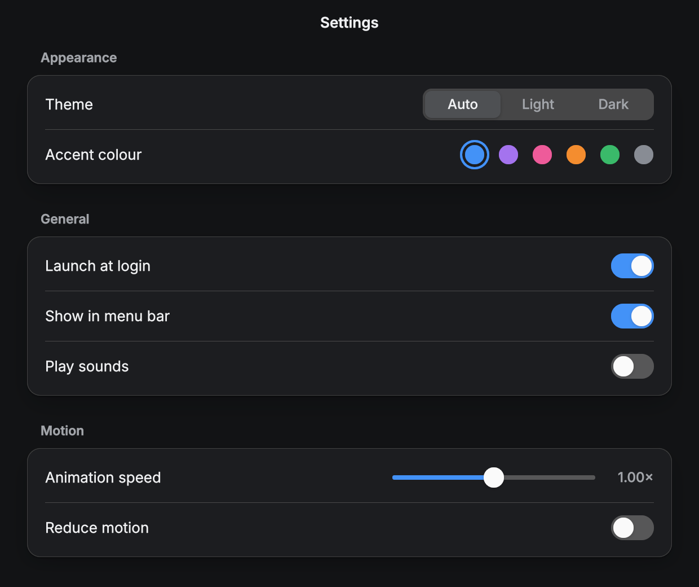
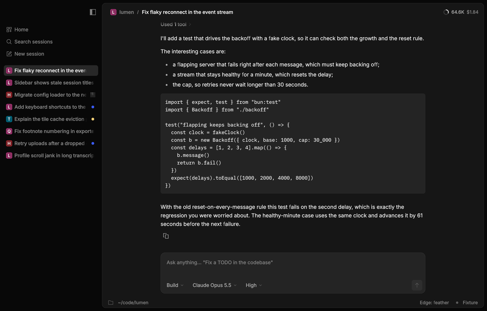
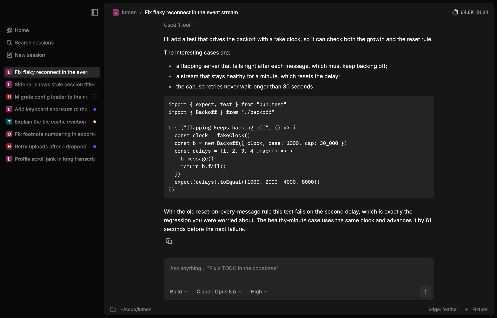
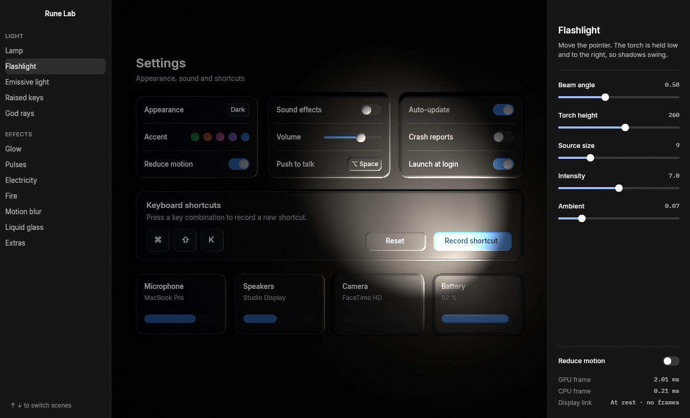

# rune

Rune's core crate: views, layout, animation, rendering, text and the native shell.
`examples/settings` draws a small Settings window entirely with Rune's own code.



## What exists

- **View API** (`el.rs`): `fn view(s: &S, cx: &mut Cx<S>) -> El`, with `row()/col()/el()/text()`,
  `.key(..)`, layout and style methods, `.on_press(|s: &mut S| ..)`, `.on_press_tx(|s, tx| ..)` and
  `.on_drag(|s, drag, tx| ..)`. Handlers are queued and run between frames with `&mut S`. Then the view
  re-runs, and the diff retargets property tracks. Hover and press only retarget tracks; they never
  re-run the view.
- **Tokens** (`tok.rs`): colours in OKLCH (dark and light themes, six accents), plus space, radius, type
  and the motion palette (snappy .25/0, default .3/0, calm .4/0, a .2/0 lead, a .15 fade).
- **Layout**: Taffy 0.15 at the target state. Text sizes round up to whole device pixels, so layout
  stays on the pixel grid. Keyed nodes retain Taffy's constraint cache between commits; only changed
  styles, children or text measurements dirty it. Text colour does not invalidate measurement.
  Three gotchas, all CSS flexbox behaviour:
  - `.grow(g)` is `flex: g 1 0`: flex-basis 0, so the element is only as big as the free space its
    parent leaves. In an auto-height column there is none, and a grown `.scroll(..)` viewport
    collapses to 0 pt. Bound an ancestor's height (`.h(..)`, `.h_full()`) or set `.min_h(..)`.
  - Flex items default to a minimum of their content size, so a nested flex column overflows its
    parent instead of shrinking and the scroll inside never scrolls. Put `.min_h(0.0)` on each
    column between the bounded ancestor and the viewport.
  - `.virtualize(..)` only works on a growth stack: call `.growth(GrowthSpec)` on the same element,
    and make it the scroll viewport's first child.

  Debug builds warn once per call site when a scroll viewport inside a `.grow()` container
  resolves to 0 pt while its content is taller; `.virtualize` without `.growth` panics with the
  element's path.
- **Animation** (`rune-motion`, `runtime.rs`): analytic springs (`Spring::new(duration, bounce)`),
  tweens, decay and transitions driven through `rune_motion::Scene` and `AnimationStore`. Retargets
  keep exact position and velocity.
  - Layout animates per edge, so stationary edges never move.
  - `.lead(lead, trail)` makes the edge in the direction of travel lead; `.width_leads()` speeds up X
    by `0.78×`.
  - Presence (`Transition`): elements added or removed after the first frame animate in and stay drawn
    until their exit settles at opacity 0 (including `.transition(Transition::blur_replace())` and
    mid-flight revival).
  - Colours animate in premultiplied OKLab, and text colour leads its background (`0.5×` duration) so
    theme switches keep label contrast through the transition.
  - Nothing animates on the first frame.
  - `Tx::instant()` applies a change with no animation (drag moves are instant by default).
  - `Tx::color_motion(spring)` sets the spring for that change's colours (the theme switch uses calm).
  - In reduced motion, spatial travel snaps while opacity, presence and colour take `REDUCED_FADE`
    (`0.15 s`). Growth-stack rows also keep this fade on insertion/removal; closing gaps land after
    the exit fade instead of animating their height.
  - The animation clock has a time scale, which the Settings speed slider drives.
- **Renderer** (`render.rs`, `shader.wgsl`): one instanced uber-quad pipeline and one draw call per
  frame.
  - Kinds: rounded rects (per-corner radius, border), analytic Gaussian shadows (outer and inset),
    vertical and angled linear gradients, circular and elliptical radial gradients (`KIND_RADIAL`),
    dashed border rings (`KIND_DASHED`), RGBA images, and glyphs from the atlas.
  - **Gradients** (`.gradient(top, bottom)`, `.radial_gradient(center, radius, stops)`,
    `.linear_gradient(angle, stops)`): painted over `.fill(..)` and under hover/press overlays and
    borders, clipped to `.radius(..)`, and composited with `.opacity(..)` and `.blur(..)`.
    `radial_gradient` takes normalized `center: [f32; 2]` (`[0.5, 0.5]` = element centre), `radius` in
    points (`f32` for a circle or `[rx, ry]` for an ellipse), and up to 8 `stops` as `(t, Color)` pairs in
    `0.0..=1.0` (inner radial bands shrink their quads to the band bounding box). `linear_gradient`
    takes `angle` in radians (CSS convention: `0.0` up, `PI / 2` right, `PI` down) and up to 8 `stops`.
    Stop colours spring in Oklab when changed and interpolate in premultiplied colour across the quad.
  - **Shadows** (`.shadow(y, blur, color)`, `.box_shadow(Shadow)`): `blur` follows CSS `box-shadow`
    (`blur = 2σ`, so the Gaussian standard deviation is `σ = blur * 0.5`). `CALayer.shadowRadius` and
    Sketch / Figma shadow blur specify `r ≈ σ`, so pass `blur = 2.0 * r` to match a `CALayer` shadow
    radius (whereas `.blur(sigma)` takes `σ` directly).
  - Vector shapes (`shape.rs`): `El::shape(Shape)` and `canvas(shape)` paint strokes (polylines,
    round or butt caps, open or closed) and fills (simple polygons, ear-clipped) in the element's own
    points, or in a `view_box` stretched to the element's size; `Path` flattens quadratic and cubic
    Béziers. Strokes are one analytic capsule/box per
    segment (`KIND_SEGMENT`); fills are triangles (`KIND_TRIANGLE`) antialiased only on polygon
    edges, so they have no seams. No atlas, so a shape can change every frame (`examples/shapes`).
    Translucent strokes blend twice where segments overlap at a joint; fills do not overlap.
  - Every instance has a soft-edge clip (`clip_soft`, `clip_fade`).
  - Colour is premultiplied linear and drawn into an sRGB target by default (linear-light blending),
    with a CoreText-calibrated luminance/scale glyph coverage exponent. Windows and overlays that want
    CSS / Core Animation gamma-space compositing for faint glows, blurs, shadows, images and video over
    dark canvases can opt into `.srgb_blend(true)` on `App`, `WindowSpec` or `ConfiguredOverlay`,
    which encodes premultiplied colours in sRGB (`Color::premul_srgb`) and renders into a non-sRGB
    target view (`format.remove_srgb_suffix()`). Ignored with a warning when a `Compositor` is set.
  - The Retina scale is applied throughout.
- **Text** (`text.rs`): Parley 0.12 lays out embedded Inter 4.1 (OFL, `assets/`). swash 0.2
  rasterises unhinted, centered, .1-point-emboldened outlines into a 2048² R8 atlas with four
  horizontal subpixel positions and pixel-snapped baselines. Colors share the same atlas masks.
  The [CoreText comparison and phase sweep](../../research/23-text-quality.md) measure weight,
  structural similarity and motion brightness variation at 1×/2×.
- **Input**: hit-testing on presented rects, pointer capture, hover and press overlays, press on
  release inside the element, and drags with a per-gesture scratch value.
  `.on_secondary_press(|s: &mut App, point, tx| ..)` receives window-point coordinates on
  right-click (also control-click on macOS), without invoking primary actions. Scripts accept
  `secondary-down`, `secondary-up`, and `secondary-click`.
- **Double press**: `.on_double_press(|s: &mut S| ..)` (or `_tx`) runs when a second press on
  the element lands within the double-click interval of the first and within 4 pt of it, and
  releases inside. `on_press` still runs for every press, the first one right away, so a row
  selects on the first click and opens on the second, as in AppKit; there's no delay to wait
  out a possible second click. A third press starts a new pair, and a press anywhere else breaks
  one. Only clicks pair: a press that travels more than 4 pt, or is held past the interval, is
  neither half of one. The interval is the system setting on macOS and Windows and 0.5 s
  elsewhere. Headless runs use the virtual clock, so a script's `double-click` (or two `click`s inside 0.5 s) is
  deterministic. Pointer only: Enter and Space run `on_press`.
- **Press scale**: `.press_scale(0.97)` shrinks an element (and its children) about its centre
  while a press on it is held, following the pointer in and out like an iOS tile, and springs back
  with a slight bounce on release. Interrupting a spring retargets it without a jump. Layout and
  hit testing keep the resting size, so a press near the edge stays inside and keeps its hover.
  Scrolling the list under a held press (wheel or fling) cancels it, as a `UIScrollView` cancels
  its content's touches: the element springs back and the release doesn't press. Elements without
  it pay nothing, and Reduce Motion turns it off. rune-kit's `Button` and `IconButton` don't use
  it: they follow `@opencode/ui` and AppKit, whose buttons don't scale.
- **Scale**: `.scale(0.5)` draws an element and everything in it at half size about its centre,
  like SwiftUI's `scaleEffect`. Layout keeps the unscaled size, so siblings don't move, and hit
  testing follows the drawn rect. It multiplies with `press_scale`, `live_scale` and scale
  transitions, and nested scales compose: a scaled child scales about its centre where its
  scaled parent draws it. Under all of them, text, icons and images scale with their box (link
  hit boxes and a text field's caret follow). Text under a still scale rasterizes at the scaled size, so it stays
  crisp. While a scale springs, text samples its rest-size glyphs, filtered, and turns crisp when
  the spring settles. That way a spring doesn't rasterize a glyph at every frame's size. Text
  under `live_scale`, or under a `scale` an app changes (a zoom slider), rasterizes at the scale
  rounded to 1/32, and a changing `scale` samples rest-size glyphs until it holds still for
  0.1 s. A matched flight's own label keeps its rest size so it doesn't pop when it lands.
- **Focus and modals**: `.focusable(true)`, `.tab_index(n)` (positive overrides, 0 document order,
  negative pointer-only), `.focus_group()` for arrow-key roving (Up/Down only, plus type-select,
  for roles `menu`, `listbox`, `list` and `tree`; Left/Right too for other groups such as
  segments and tabs; `list`, `tree` and `grid` stop at their ends while menus and segments wrap), `.focus_follows()` to press each item it
  reaches, `.focus_selected(on)` for a group's initial Tab stop, `.focus_ring(width, offset,
  color)` for keyboard-only rings, and `.focus_highlight(color)` for a menu row's shared pointer
  and keyboard highlight. Enter/Space
  activates non-text controls. `.modal(click_outside, close)` traps Tab, handles Escape, makes the
  background inert and restores the opener. Nested modals restore in stack order. Inspector tree
  flags (`focusable`, `focused`, `focusVisible`, `inert`) are the future platform AX hook.
- **Periodic motion**: `.looping(rune_motion::LoopSpec::opacity(..))` or `LoopSpec::rotation(period)`
  (icon quads). Tracks use animation time, preserve phase when retimed and only request frames
  while visible through ancestor clips. Removal uses the existing spring presence fade. Reduced
  motion holds the first pose; time scale 0 pauses. Occluded windows stop drawing.

Commit layout runs through a `Measurement` capability that can access text/layout
caches and virtual geometry, but cannot access the scene, animation tracks, draw
instances, or mutable app state. It finishes all measurement retries before
returning an owned `Measured` result. Scene mutation consumes that result; motion
policy changes are applied in the same mutation phase.

### Rich text, scrolling and app hooks



- **Rich text** (`rich(text, spans)`): per-range weight, colour, family, background and underline
  (`Span`), wrapping with absolute line height and letter spacing, `.truncate()` with an ellipsis, and
  inline-code backgrounds that merge where they touch. `.align(..)` and `Node` insets keep text inside
  padding and borders.
- **Fonts as data**: `AppSpec::fonts` embeds faces and `AppSpec::families = (ui, mono)` names them.
  `TextStyle` picks a `Family`.
- **Icons** (`icon(&Icon, size)`): SVG icon bodies (as in `@opencode/ui`'s catalog) rasterised into
  the glyph atlas.
- **Themes as data** (`theme.rs`): `Theme::from_json(src, dark)` reads named tokens (hex, rgba or
  references, plus numbers). `"blend": {"mode": "srgb", "over": token}` re-solves translucent tokens so
  linear-light blending matches a browser's sRGB blending (`srgb_equivalent`, `Theme::alpha`). An app's own theme lives
  in the app; core ships only the format.
- **Scrolling** (`.scroll(ScrollSpec { stick_bottom })`): a runtime-owned fractional offset, wheel 1:1,
  fling decay, and follow-the-end. A new viewport opens at its end on its first frame.
- **Virtual rows** (`.virtualize(estimated_row_height)` on a growth stack directly inside a scroll
  viewport): only an overscanned window has Taffy, shaped text and scene nodes. Rows need unique
  keys and internal vertical padding rather than margins or stack gaps. Unvisited heights are
  estimates; measured corrections preserve the visible key and the bottom stays exact. Historical
  rows remount settled. The measurement pass expands the window before drawing if estimates leave
  a gap. Render coordinates are rebased near the window and scroll extents use double precision.
  View construction still visits every row; a lazy view API is a remaining optimization.
  `tx.scroll_into_view(key)` reveals a row, including one outside the realized window.
  `.scroll_edge_fade(w)` fades a viewport's top and bottom only while content is hidden under
  them (strength = hidden extent / 15 pt), and `.scroll_margin(pts)` stops revealed rows clear of it.
- **Timeline growth** (`.growth(GrowthSpec { spring, edge })`, `growth.rs`): rows of a stack ease
  their heights render-side on `GROWTH` (0.32 s, bounce 0) in fixed 1/240 s substeps, so 30, 60 and
  120 fps give the same curve. Desktop's per-frame caps are per-second here (start, ramp, max, long,
  carrying-tail, near-target), and every row eases into its target. Positions come from the presented
  heights above, on the 1/64 px grid. Leaving rows close after 0.15 s and fade in place.
  `.streaming(true)` marks the growing tail. Its last wrapped line holds back up to .52 line heights
  (one line) or .82 (multiple lines), proportional to unfilled width. Measurement reuses Parley's
  shaped layout. A width rewrap can shrink the row; completion lands at its full measured height.
- **Stream edges** (`edge::{FEATHER, FAST_FEATHER, NO_MASK, WORD_FADE}`): the feather mask under a
  growing row and the word-fade duration. `.reveal(word_fade)` fades appended words in, staggered from
  20 ms down to 5.5 ms as a backlog builds.
- **Settling** (`Tx::settle()`): no animation, every track lands, and removed nodes unmount at once.
  Opening a session lands at the bottom on its first frame with nothing animating in.
- **Turn actions**: the OpenCode example reserves a stable tail and crossfades Working into the
  Desktop copy icon over .34 s, without removing and re-adding the tail's height. `Tx::copy(text)`
  requests a shell clipboard write. Requests follow handler order; headless runs never write the
  system clipboard.
- **Text input** (`text_input(&edit, style)`, `edit.rs`): caret, selection, word and line motion,
  select all, copy, cut and paste, undo, and IME preedit through winit (see [Text fields](#text-fields)). `.on_edit(..)` binds the `TextEdit` in app
  state and `.on_submit(..)` runs on Enter.
- **App hooks**: `AppSpec::setup` (once, with a `Waker` for background threads), `poll(state, clock,
  tx)` before every frame, `on_key`, and `extra_args()` for the app's own flags.
  `tx.wake_after(Duration::from_millis(250))` schedules a poll on the unscaled app clock,
  even when poll returns false. Equal deadlines coalesce; the shell sleeps until the earliest
  deadline without a timer thread. Headless steps visit deadlines exactly. For debounce, store
  the latest due time in state and reschedule its remainder when an older wake arrives.
- **Modifier keys alone**: `App::modifier_keys()` (also on `WindowSpec` and `ConfiguredOverlay`)
  sends Shift, Control, Option/Alt, Command/Super and Fn going down and up on their own to
  `on_key` and the focused field's key handler, as `Key::Modifier { modifier, pressed }`, with
  the side (`Modifier::AltRight.side() == Some(KeySide::Right)`). `mods` hold the state after
  the change, as AppKit's flagsChanged does. Off by default; they never type, select, move focus
  or fire shortcuts, and a chord still arrives as before. Fn reaches macOS windows and overlays
  only: Windows and Linux keyboards handle Fn in firmware and never report it.
- **Tooling**: scripts gain `type`, `key`, `paste`, `scroll` and `fling`. Traces carry motion-trace
  intents (settle cuts, growing rows, word reveals) and clipped visible rects.

### App lifetime (`app.rs`, for apps that outlive their window)

`rune::run(spec)` opens one window and quits when it closes. `rune::App` gives the app its own
lifetime (`examples/background` exercises all of it):

```rust
let app = rune::App::new(spec)
    .init(move || Ui::new(host))   // first state from a closure (scenes still apply)
    .args(Vec::new())              // Rune flags from here, not the process argv
    .windowless()                  // start with no window (implies keep_running)
    .keep_running()                // closing the window keeps the process, state and loop
    .release_gpu_when_closed()     // optional: drop the GPU device while closed
    .accessory()                   // macOS: menu-bar app, no Dock icon (h.set_dock_icon(true) shows it)
    .on_close(|s, tx| ..);         // runs before every close; tx.quit() quits instead
    // .window_options(WindowOptions { max_size, resizable, .. }) for this window
let handle = app.handle();     // AppHandle<S>: Clone + Send + Sync, usable before run
std::thread::spawn(move || {
    handle.activate(token);    // show + focus with a forwarded XDG activation token
    handle.open();             // show + focus without one
    handle.update(|s, tx| ..); // change state on the UI thread; commits on the next frame
    handle.close();            // as the close button (on_close runs)
    handle.quit();             // run returns
});
app.run();
```

- Every handle call wakes the loop; nothing polls. Updates run in call order on the main thread
  inside the event loop, even while no window shows, so a closed app keeps its state current and
  an update may do main-thread native work (a status item, a tray). Window requests collapse to
  the latest.
- Handlers ask the shell with `Tx::close_window()` and `Tx::quit()` (quit wins).
- The `Runtime` (state, scene, text, scroll offsets) belongs to the app, so a reopened window
  shows the same UI, settled on its first frame. The GPU device and renderer stay too, unless
  `release_gpu_when_closed` (then closing destroys the window and device everywhere).
- Closing hides the window on macOS, Windows and X11, and destroys it on Wayland (no hidden
  toplevel exists there); `open` recreates it with the same app id (`set_app_id`).
- Activation: the first window takes the launcher's `XDG_ACTIVATION_TOKEN`/`DESKTOP_STARTUP_ID`
  and clears them from the environment. A new window gets a forwarded token through winit's
  `with_activation_token`. An open Wayland window is activated with `xdg_activation_v1` bound on
  winit's own display (`activation.rs`), since winit 0.30 can't. Without a token Wayland can only
  request attention (most compositors mark it urgent); X11, macOS and Windows use `focus_window`.
- Headless tooling runs ignore window requests and apply updates before each frame.
- `AppHandle::is_visible()` reports whether the window is on screen; `AppHandle::window_error()`
  says why it couldn't be created (no display, no GPU adapter or device). A failed creation is
  logged and leaves the app windowless; the next open tries again (`Gpu::try_new`).
- `run` panics when the event loop can't start: no Wayland or X11 display, or a Mac no one is
  logged in to (over ssh or in CI). `App::try_run`, `try_run_windows_with` and
  `try_run_windows_with_args` return that error instead.
- `App::on_window(|w: &WindowHandle| ..)` runs on the UI thread after every native creation, for
  icons or native styles through `WindowHandle::with_raw_handle`.
- `AppSpec::min_size` sets the smallest window (None keeps 420×400).
- `AppHandle::set_dock_icon(bool)` switches macOS between the regular and accessory activation
  policies at runtime.
- Edge overlays (HUDs): see `App::overlay` below.

### Compact tray-controlled windows

Use `WindowOptions` on a `WindowSpec`. Existing single-window defaults
remain resizable, decorated, with a 420×400 minimum unless `AppSpec::min_size` is set.

```rust
spec.size = (320.0, 160.0);
let app = rune::App::new(spec).windowless().keep_running();
let tray = app.handle();
// Any thread, including a tray callback:
tray.set_position((-320, 80)); // physical desktop pixels
tray.show();                  // no focus request; recreates a destroyed window
tray.focus();                 // a separate, explicit activation request
// tray.hide() keeps state without invoking on_close; tray.open() shows and activates.
rune::run_windows_with_args(rune::RunOptions { accessory: true }, [], move |_| {
    vec![rune::WindowSpec::from_app("call", app).options(rune::WindowOptions {
        min_size: Some((320.0, 160.0)),
        max_size: Some((320.0, 160.0)),
        resizable: false,
        borderless: true,
        always_on_top: true,
        ..Default::default()
    })]
});
```

Size constraints use logical points. Placement and topmost work through the native
window manager on macOS and X11; they are no-ops on Wayland. Runtime changes survive
close/recreation. On Wayland, use `activate(token)` for authorized focus; tokenless
`focus()` requests attention. `show()` leaves minimized windows minimized; `open()`
also restores them. On macOS, no-focus show uses `orderFrontRegardless`, rather than winit's
`makeKeyAndOrderFront`. Window-manager focus policy still applies. `WindowHandle`
also provides show/hide/focus, placement and topmost control on the event thread.
The app owns its tray; Rune supplies the window lifetime and handles.
`RunOptions::accessory` applies the macOS process policy before the event loop is
created: no Dock icon/default menu and no activation at launch. Other platforms
ignore it; `run_windows` keeps its regular-launch default.

### Resizing and centring a window

```rust
// In a handler: the next onboarding step is taller.
tx.motion(rune::tok::motion::SNAP);  // optional; tok::motion::DEFAULT otherwise
tx.resize_window((480.0, 600.0));    // content size in points
tx.center_window();                  // optional: centre the new size, on the same spring
// tx.resize_window_instant(size) or tx.instant() jumps.

// From outside a handler, on the event thread:
window.resize((480.0, 600.0));       // WindowHandle; also resize_instant, center

// Or let the content set the height, like SwiftUI's `.windowResizability(.contentSize)`:
rune::App::new(spec).fit_content_height().run();
```

- The top edge stays put and the window stays on its screen: growing past the bottom lifts
  it just enough, and a window the user dragged partly off screen moves no further off.
- Sizes stay inside the window's `min_size` and `max_size` (`WindowOptions`, else
  `AppSpec::min_size`) on every platform. Headless runs apply only limits the app set.
- `center_window` matches AppKit's `center`: centred across, with a quarter of the spare
  height above and three quarters below.
- On macOS the frame moves on a Rune spring, one display frame at a time. Each frame sets the
  window's frame before taking its drawable and lays the content out at the new size, and
  drawables present inside the frame's Core Animation transaction while it moves, so content
  pinned to an edge follows it with no stretched, stale or blank strip. Content at rest
  follows the window; layout springs and matched flights already running keep going. A
  resize mid-flight keeps its speed. Dragging the window mid-flight wins: it stays where the
  user puts it and the size carries on from there. Hiding or minimising it lands the frame.
  Reduced motion jumps.
- Windows and Linux resize at once with `request_inner_size`. Wayland can't see or set a
  window's position, so it resizes without being kept on screen and ignores centring.
- Headless runs move the viewport on the virtual clock, so `--tree` and scripts see each
  step; frames keep the launch canvas size, and centring does nothing.
- A requested size outlives the window: a closed window reopens at it.
- `fit_content_height` lays the root out at its natural height for the window's width (give
  it no fixed or `fill` height), opens at that height and follows the content on each
  change's spring. A width change jumps, and a window the user resizes goes back to its
  content's height. Unless the app sets a minimum, its minimum height is 0 rather than the
  default 400 pt.
- Overlays ignore these; use `OverlayHandle::resize`.

### Window chrome and shell controls (OpenCode Desktop fidelity)



- **`App::chrome` / `WindowSpec::chrome`** (`Chrome { full_size_content, traffic_lights, drag_regions }`, or `Chrome::DEFAULT`): on
  macOS, `full_size_content` gives a transparent titlebar with content under it, and
  `traffic_lights: Some((x, y))` places the close button's top-left at `x, y` points (Electron's
  `trafficLightPosition`). Rune places the buttons again after every resize, scale change, focus change
  and un-occlusion. On Windows and Linux both options do nothing; the system titlebar stays.
- **`AppSpec::new(title, size, init, view)`** fills every other field with its default; literals
  that set a few more end with `..AppSpec::new(..)`. Window chrome lives on the builders, keeping
  existing exhaustive `AppSpec` literals source-compatible.
- **Window drag regions** (`.window_drag()`): a press starts winit's `drag_window` and a
  double press zooms the window (macOS follows the user's `AppleActionOnDoubleClick` setting, so it
  may minimise instead; elsewhere it toggles maximised). With `Chrome::drag_regions` on macOS, only
  marked regions move a borderless or full-size-content window, so titlebar content stays clickable.
  Rune subclasses only that window's content-view instance; ordinary titled windows and NSPanel
  overlays retain their native behaviour.
- **Hover groups**: `.hover_group()` (or any `.hover(color)`) tracks hover for a subtree, and
  `.hover_motion(enter, exit)` sets its curves (for example a delayed reveal). Descendants read the
  nearest group with `.group_opacity(rest, hovered)` and `.group_color(c)`. A group stays hovered
  while one of its descendants holds the press, and only counts the part of it that shows inside a
  clipping parent.
- **Loops** (`.cycle(Cycle { period, phase, stops, still, fps })`): an opacity loop sampled from the
  clock through `El::looping`, with one loop engine in rune-motion,
  so every loop with the same period stays in phase. Reduced motion holds `still`. While only loops
  move, the window wakes at `fps` instead of every display frame, and a still window does no work.
- **Drags** report `dx, dy`, the pointer's travel since the press.
- **`--chrome`** (headless) paints the traffic lights and a 4 pt clearance box onto snapshots and
  prints any element that overlaps them.

### Finite choreography

`El::sequence` uses the same render-clock tracks as loops, then holds the final pose
and sleeps. No app phases, poll callback, or `wake_after` calls are needed.

```rust,ignore
use rune::{Beat, Sequence, el};
const MOMENT: &[Beat] = &[
    Beat::new(0.0).opacity(0.0).scale(0.96),
    Beat::new(0.3),
    Beat::new(0.6).opacity(0.6).scale(1.04),
    Beat::new(0.9),
];
el().key("moment").sequence(Sequence::new(MOMENT).delay(0.1))
```

Each beat is a full opacity/scale pose at elapsed seconds; omitted values are 1.
`Beat::easing` sets the arriving segment's easing (default ease-in-out). Unchanged
specs keep their progress across commits; changing the spec or mounting a new key
replays it. Reduced motion and explicit settle land the final pose immediately.
Scale changes presentation, not layout. This finite API is separate from the
lower-level `rune_motion::Keyframes<T>` property-track builder.

### Shared-element motion

`El::matched(id)` is SwiftUI's `matchedGeometryEffect` (Motion's `layoutId`). When an
element with an id leaves the tree in the same commit that another with that id mounts
somewhere else, the new one starts where the old one was seen, with its velocity, corner
radius, fill and opacity, and springs to its own layout. Both places are ordinary layout:

```rust,ignore
fn tile(s: &State, i: usize) -> El {
    let id = format!("tile-{i}");
    el().key(id.as_str()).matched(id.as_str()).grow(1.0).radius(20.0).clip_rounded(20.0)
        .child(el().w_full().h_full().pixels_fit(&s.pictures[i], SurfaceFit::Fill))
}

if s.zoomed {
    stage.child(tile(s, s.picked))                      // the whole stage
} else {
    stage.child(col().key("grid").grow(1.0).gap(12.0)   // a 2×2 grid
        .transition(Transition::scale(0.96))
        .child(row().key("top").grow(1.0).gap(12.0).child(tile(s, 0)).child(tile(s, 1)))
        .child(row().key("bottom").grow(1.0).gap(12.0).child(tile(s, 2)).child(tile(s, 3))))
}
```

`examples/matched` is this Grid → One zoom (1–4 pick, ↩ zoom, Esc back).

- **Scale, not reflow.** The flying element's children keep their final layout, scaled
  uniformly to cover the moving frame (centred) and clipped to it, so a filled picture
  zooms without distorting and nothing re-lays out per frame. Text moves with its box but
  keeps its size, as under any scale, so a label doesn't pop at the swap.
- **Above everything.** A flight paints after the rest of the window, outside its
  ancestors' opacity, scale, blur and rounded clips, so an entering or exiting parent
  (the grid's scale-and-fade above) never hides it.
- **Clipping.** It keeps its destination's rectangular clips, a scroll viewport's
  included, and starts from where the source was seen after its own viewport's scroll.
- **Interruptible.** Matching back mid-flight starts from the presented rect with its
  velocity; a commit that leaves its layout alone doesn't re-time it.
- **Spring.** `tok::motion::REFLOW` unless the commit's `Tx::motion` or the element's own
  `.motion()` sets one. Under reduced motion nothing is matched: the old element exits and
  the new one enters by their own transitions, in place. Settle and first frames swap.
- **Nesting and removal.** A matched element inside a flying one flies its own path. A
  flight lands once the ancestors it sits in stop moving, scaling and fading. One removed
  mid-way exits by its own transition, still above everything.
- **Ids are per window.** When two present elements share an id, the last in tree order is
  matched; `--tree` lists a warning and debug builds print one.
- Elements without a counterpart play their own transitions. Without any `matched`
  element, the runtime does no extra work and draws the same pixels. A flight costs a
  scan of the flying list per drawn node, and its subtree paints in tree order.

## High-frequency values

`LiveText` updates a plain text run without rebuilding the view or moving its
siblings. Reserve a box with a placeholder or an explicit size:

```rust,ignore
let clock = rune::LiveText::new("00:00");
text("00:00").live_text(&clock).font(TextStyle::new(14.0, 400.0).features("'tnum' 1"));
clock.set("00:01");
```

The placeholder determines layout even after a view rebuild. Only the changed
run reshapes; overflow clips to that box. Equal strings do not shape or wake a
host. Hidden hosts keep the latest value and sample it on return. Publication
uses a short mutex and can allocate; it is not an audio-callback API. Live text
supports plain single-line labels, including `.truncate_fade()`, but not rich
spans, wrapping, editors, ellipsis truncation or streaming word reveals.

`TextStyle::features("'tnum' 1, 'ss01' 1")` enables OpenType features, and
`.variations("'wght' 500, 'opsz' 14")` selects variation axes. Both use CSS syntax
and participate in the layout cache key. Tokens remain `Copy` and const-friendly;
these strings have static lifetime. `.optical_size(value)` accepts a runtime value.

Register extra font bytes in `AppSpec::fonts`, then select their embedded family
name with `TextStyle::new(32.0, 400.0).family(Family::Named("Anton"))`. The name is a
literal family name, not a CSS list or filename. Named families fall back to the
sans slot when absent or missing a glyph, followed by the existing symbol/script
fallbacks. `Family::Sans`, `Family::Mono`, and `.mono()` keep their existing meaning;
mono rich spans still use the mono slot. Named styles remain `Copy` and const-friendly
and the family name participates in the layout cache key.

`.family(Family::SystemMono)` uses the platform's monospaced UI font without bundling it:
SF Mono on macOS (the face AppKit's `monospacedSystemFont` returns, matched to within
0.05 pt per glyph at 8 to 34 pt), Cascadia Mono, then Consolas, on Windows, and whatever
fontconfig resolves `monospace` to on Linux (then DejaVu Sans Mono, Liberation Mono, Noto
Sans Mono). Its files load the first time a text asks for it. Where none is installed it
falls back to the mono slot. SF Mono has no `trak` table, so it is untracked, as in AppKit;
`tracking` still adds, and glyphs that fall back to the system font get that font's own
tracking. Mono rich spans keep using the mono slot.

To put the mono slot itself (so `Family::Mono`, `.mono()` and mono rich spans) in that
font, name CSS's `ui-monospace` in it: `families: ("Inter", "ui-monospace")`. It stands for
the same families as `Family::SystemMono`, and the rest of the list follows it, so
`"ui-monospace, Menlo"` falls back to Menlo where none is installed. Inline code then
matches a code block set in `Family::SystemMono`.

Optical sizing defaults to each run's point size, including rich spans with a
different size. An explicit `opsz` variation wins over the default; `.optical_size`
wins over both. `.optical_sizing(OpticalSize::FontDefault)` restores Parley's old
selection. The point-size default tracks CoreText more closely in measured SF samples.
Fonts without an `opsz` axis are unaffected.

`.truncate_fade()` shrinks a single-line label and fades its trailing 1.5 em edge
only when text overflows (`.truncate_fade_width(em)` sets another width). It keeps the full string and paints no ellipsis. For
end-aligned labels the overflow fades on the left.

`.truncate_middle()` cuts like `.truncate()` but keeps both ends, "…" replacing the
middle (AppKit's `NSLineBreakByTruncatingMiddle`), for paths and file names;
`.truncate_head()` keeps the end. Cuts fall between graphemes and refit on resize, and
selecting, copying and `--tree` keep the whole string.

`.max_lines(n)` wraps and stops after `n` lines, "…" ending the last when more would
follow (CSS `line-clamp`). The element measures at most `n` lines tall; the cut falls
between graphemes (inside a word too wide for the box too), spans and links keep their
looks up to it, and copying and the accessibility text keep the whole string. Text fields
ignore it.

Native hosts populate `cx.system_reduced_motion()` at creation and refresh it on
window focus changes. Rune uses it by default; `cx.reduced_motion(value)` overrides
it **for the current commit only**. Call it each time the view runs to keep an
override; otherwise the next commit uses the host preference. macOS reads the accessibility preference, Windows reads client
area animation, and Linux reads KDE's duration factor or GNOME's enable-animations
setting when available. The preference lives on Runtime/Cx, so existing
`Env { system_dark, scale }` literals remain valid. Headless runtimes default to
false; tests can call `rt.set_system_reduced_motion(value)` and inspect
`rt.system_reduced_motion()`.

A root `.on_window_focus(|state: &mut State, focused, tx| ...)` receives native
activation/deactivation in order. It applies to regular windows and interactive
overlays, independently of text-field focus. Headless tests inject the same events
with `Runtime::window_focus(bool)`.

`Live<T>` is a cloneable, thread-safe latest-wins handle (`f32`, `[f32; 2]`,
`[f32; 4]`, `Color`). Call `set(value)` from a producer thread; Rune coalesces a
wake for each visible subscribed window. Equal values and hidden windows do not
wake. Bind with `.live_opacity(&level)`, `.live_offset(&cursor)`,
`.live_scale(&scale)`, `.live_fill(&color)` or `.live_rect(&rect)`.
`cursor.smooth(Spring::new(0.16, 0.0))` opts a binding into rune-motion smoothing.
Views and layout do not rerun. Rects are presentation `[x,y,w,h]` in parent points,
so text does not rewrap and siblings do not reflow. See
[`examples/live-values`](../../examples/live-values) for background producers,
deterministic snapshots/traces, allocation gates and the rebuild comparison.

The native shell samples after acquiring a drawable. This is still the main-thread
renderer, not a dedicated late-uniform/render-thread path. `Live::new` requires
lock-free 128-bit atomics on the host CPU. Publication allocates nothing; platform
wake callbacks are not hard-real-time guarantees.

For a countdown, keep a `Tween` in app state and bind it through a live property:

```rust,ignore
let bar = rune::Tween::linear(
    [0.0, 0.0, 272.0, 4.0], [0.0, 0.0, 0.0, 4.0],
    std::time::Duration::from_secs(30),
);
// In the view:
el().size(272.0, 4.0).live_rect(&s.bar)
```

The track starts on first attachment to a runtime and uses elapsed real time
(virtual time in headless runs). Rebuilds retain progress; replacing the `Tween`
starts a new track. It needs no app ticks, layout, shaping, or timer wakes.
Hidden windows stop sampling and resume at the elapsed value. At the endpoint
the renderer sleeps. This is a timed value, including under reduced motion;
it does not use the decorative motion spring or jump to the end on settle.
The shared handle retains each runtime's start across unmount/remount (including
virtual-list culling). Replacing the handle, rather than remounting the view,
starts a new countdown.

## Text fields

`TextEdit::focused` is maintained by the runtime. Set it once to request focus, then
let the runtime clear it when another field takes focus; do not force it on every view rebuild.

Text fields support Cmd/Ctrl-Z and Cmd/Ctrl-Shift-Z. Consecutive typing is one undo
group; selection changes, navigation, paste, cut and IME commits separate groups.
Undo restores selection direction as well as text. History shares storage with view
snapshots and retains at most 128 edits / 1 MiB of text (oversized edits drop history).
Call `TextEdit::clear()` after submission to clear history while retaining focus;
call `break_history_group()` when setting a selection from custom pointer handling.

Use `TextEdit::new("").secure()` or `text_input(&edit, style).secure()` for passwords;
kit's `TextInput::secure()` passes it through. Each Unicode scalar displays as one
bullet, with model-byte selection and caret positions mapped to those bullets.
Secure fields have no undo, copy, cut, IME composition, or inspector text. macOS
Secure Event Input is held only while their native window is focused and visible.
Model buffers and history wipe on drop; secure edits wipe replaced allocations.
Use `replace_text(..)` or `clear()` for programmatic replacement. Direct assignment
to the public `text: String` field bypasses replacement wiping.

`tx.copy_secret(text, Duration::from_secs(30))` writes with the platform's clipboard
history-exclusion marker and expires on Rune's shared clipboard worker. Expiry
compares the current text and, on macOS/Windows, the clipboard revision; copying
something else cancels the old expiry. Linux's portable API exposes no revision,
so it compares text. Clipboard managers must honor the platform marker themselves.

Put `.on_paste(|s: &mut State, text: &str, tx| { ... })` on the view root (or modal
root) to handle Cmd/Ctrl-V when no field is focused. `tx.request_paste()` requests
the same asynchronous clipboard read from a button, including in overlays.
Focused editors take precedence; late reads are discarded if the target changed.
Headless `--script` `paste` supplies text directly through the same routing and
records `paste window` or `paste field` in `--trace`, without recording contents.

`tx.fly_text("prompt", "sent-text")` hands a visible plain-text field to a newly
mounted, uniquely keyed text node. The runtime captures its visible glyphs before
committing and measures the destination after growth/scroll each frame. One 0.32 s
growth-spring progress drives the screen-space handoff; reduced motion uses a
150 ms crossfade. `settle()` lands it immediately. Neither view code nor handlers
measure presentation geometry.

### Selectable text

`text(..).selectable(true)` lets people select and copy read-only text, as SwiftUI's
`.textSelection(.enabled)`: drag across it, double-click a word, triple-click a paragraph,
shift-click to extend. Cmd+C (Ctrl+C off macOS) copies and Cmd+A selects all of it while it holds
the selection; a right-click opens a native Copy menu on macOS unless the element has its own
`on_secondary_press`. It shows the I-beam (a link inside it keeps the pointing hand and opens on
click), isn't a Tab stop, and a press anywhere else clears it. One text holds the selection at a
time. It works across spans, wrapped lines and bidi runs. Cmd+C and Cmd+A are the plain chords
only: with Shift, Option or Control added they go to the app. A click on the text makes it the
holder, so Cmd+A selects all of it, as in an AppKit text view; Cmd+C with nothing selected goes to
the app. A view that changes the text, removes it or turns `selectable` off drops its selection.

Inside a row that handles input, the row keeps it: an unmoved click on the text presses (and
double-presses) the nearest ancestor with a handler, hover and press paint reach that ancestor,
and its `on_secondary_press` wins over the Copy menu. A drag that selects text doesn't press.
Inside a draggable row (`on_drag` or `drag_out`), dragging drags the row and double- and
triple-clicks still select words and lines. Text with its own handlers keeps them.

The selection lives in the runtime, so selecting never re-runs the view or re-lays out the text.
`El::selection_color` sets the highlight for selectable text and text fields alike, and both draw
it the same way; kit's `k.selection()` is the colour its `TextInput` uses, so pass it to match.
`Runtime::text_selection()` and `selected_text()` read the selection; `--tree` marks the text's
node `selected` with the selected string, and scripts gain a `triple-click` event.

```rust
text(&command).font(k.ty.mono).selectable(true).selection_color(k.selection())
```

### Help tooltips

`.help("Copy command")` shows a tooltip after the system hover delay while the pointer rests on
an element, as SwiftUI's `.help`. A press, scroll, key or the pointer leaving hides it, and it
stays hidden until the pointer leaves and comes back. It follows the element if it moves, and it
takes no hover or clicks from anything under it.

On macOS it's AppKit's own tooltip: the window registers each help rect with
`addToolTipRect:owner:userData:`, snapped to device pixels, and replaces only the rects that
moved, so scrolling a list doesn't restart a still toolbar button's tooltip. Elements behind a
modal register nothing, and the parts of an element under something drawn over it (a popover)
are left out. The delay, look and placement are the system's. Overlays draw theirs on every
platform: AppKit shows tooltips only in the active app, and most overlays are non-activating
panels. Elsewhere Rune draws it: Windows' tooltip control and GTK's would need
to own the window procedure or toolkit that winit already owns, and Linux and the web have no
toolkit-free tooltip API. The drawn tooltip waits 0.5 s (the double-click time on Windows; set
`Runtime::help_delay` to change it), sits under the element or above it when there's no room,
stays inside the window, and follows the theme's light or dark appearance. Headless runs always
draw it, so `--snap` shows it and `--tree` has a top-level `tooltip` object.
`Runtime::help_regions()` and `help_tooltip()` read them; `--tree` carries each element's `help`.

### File dialogs

Enable Rune's `native-file-dialog` feature and inject `FileDialogs::native()` in the shell.
`dialogs.open(options).await` and `dialogs.save(options).await` return an optional path
(None means cancelled). `FileDialogOptions` carries title, directory, suggested filename and
`.filter("Audio", &["wav", "flac"])`. rfd handles Cocoa on macOS and the XDG portal on Linux;
poll these futures on the app's async executor and wake Rune when the result arrives.
Never block the window's main thread with `pollster::block_on` for a native dialog;
Cocoa needs that thread's event loop to present and complete it.

Headless fixtures inject `FileDialogs::scripted([ScriptedFileDialog { kind:
FileDialogKind::Open, path: Some("/fixture/recording.wav".into()) }])`. Requests resolve
without a window; wrong request order or exhausted fixtures return an error.

### Dragging out to other apps (`drag_out`)

`.drag_out(..)` makes an element a system drag source: drag it into Finder, Mail or System
Settings and the other app receives files, PNG data or text.

```rust
el().child(text("Example"))
    .drag_out(|s: &App| Some(DragItem::new().file("/Applications/Example.app")))
    .on_drag_end(|s: &mut App, outcome, _tx| s.last_drop = Some(outcome))
```

The closure runs once the pointer travels `DRAG_THRESHOLD` (4 pt; 8 pt on Linux) from the press,
so it can read current state; `None` cancels this drag and the press stays a press. A press
released before the threshold still runs `on_press`; a drag-out element never runs `on_drag`.
Once the system drag starts, Rune drops the pointer capture and hover, so nothing stays pressed.
Files are offered as copies (`DragItem::allow_move` also offers a move), an app bundle can be
dropped into System Settings' privacy lists, and the picture under the pointer is a snapshot of
the element unless `DragItem::image` sets one. `on_drag_end` receives `DragOutcome::Copied`,
`Moved`, `Linked` or `Cancelled`.

macOS only for now. Elsewhere `drag_out` is ignored and the element keeps its press and
`on_drag` behaviour. Headless runs record `drag-out <path>` in `--trace` and mark the node
`dragOut` in `--tree`. `examples/drag-out` drags a file, an app and some text.

### Pop-up and context menus

`tx.popup_menu(menu, anchor, on_pick)` opens a native menu once the handler's frame is done.
`on_pick` runs like an update, with the picked item's id after the menu closes, or `None` when it's
dismissed. It's called exactly once per request. A menu asked for while another is open waits its
turn. Hiding, closing or quitting the window ends a tracking menu and answers every waiting request
`None` first.

```rust
row().key("theme").child(text(theme_title(&s.theme)))
    .on_press_tx(|s: &mut Settings, tx: &mut Tx| {
        let menu = PopupMenu::picker([("system", "System"), ("light", "Light"), ("dark", "Dark")], &s.theme);
        tx.popup_menu(menu, "theme", |s: &mut Settings, picked, _| {
            if let Some(id) = picked { s.theme = id.into(); }
        });
    })
// A context menu at the pointer:
.on_secondary_press(|_: &mut Settings, press, tx: &mut Tx| {
    let menu = PopupMenu::new()
        .item(PopupItem::new("copy", "Copy").symbol("doc.on.doc").key_equivalent("cmd+c".parse().unwrap()))
        .item(PopupItem::new("paste", "Paste").enabled(false))
        .separator()
        .submenu("Share", PopupMenu::new().item(PopupItem::new("mail", "Mail")));
    tx.popup_menu(menu, press, |s: &mut Settings, picked, _| { /* … */ });
})
```

- **Anchors**: an element key opens over that element's drawn rect. With a `selected` item
  (`PopupMenu::picker` sets it), that item sits over the element and the menu is at least as wide,
  as a SwiftUI menu-style `Picker` opens. Without one, the menu drops down from the element's
  bottom-left. A `PointerPress` or `(x, y)` in window points opens the menu there.
- **Items**: `PopupItem::new(id, title)` with `.enabled`, `.checked`, `.key_equivalent` (a hint;
  the menu doesn't register the shortcut) and `.symbol` (an SF Symbol name on macOS 11+).
- **Platforms**: macOS uses `NSMenu`'s `popUpMenuPositioningItem:atLocation:inView:` in windows
  and overlay panels. The menu tracks from a run-loop block outside winit's handler, so frames,
  springs, the display link and `AppHandle::update` keep running while it's open. The pointer's
  press, capture and hover are released before it opens. Elsewhere `popup_menu_supported()` is
  false and `on_pick` gets `None` on the next frame, so keep an in-app fallback for those
  platforms. `cargo run -p rune --example popup_menu` shows both kinds.
- **Headless**: `--tree` has a `popupMenu` object (items, anchor, `selected`, `queued`) while a
  menu is open, and `--trace` notes `popup-menu:open`, `popup-menu:pick:{id}` and
  `popup-menu:cancel`. Scripts answer it with `{"type": "menu-pick", "id": "dark"}` or
  `{"type": "menu-cancel"}`.

## Multiple windows and overlays

`run_windows(|displays| Vec<WindowSpec<S>>)` creates independent retained trees on
one winit event loop. Each spec has a stable key, an `AppSpec`, optional supplied
state, and `WindowOptions`. Share Live handles/services between window states.
Windows share one GPU device, with independent renderers and text atlases.
`WindowOptions::overlay(display)` selects transparent, borderless, topmost,
click-through presentation at that display's physical origin and size. Options
also support initially hidden windows and per-window minimum sizes.

`WindowSpec::on_created` receives a weak `WindowHandle`: toggle click-through,
visibility and topmost status, close a window, borrow its raw-window-handle, or
read its macOS `window_number()` (CGWindowID) for ScreenCaptureKit exclusion.
By default closing a window releases its runtime; the last window closes the app. Input,
focus, clocks, redraws and visibility-gated live wakes are window-local.

`WindowSpec::from_app(key, app)` preserves `AppHandle`, `windowless`, `keep_running`,
close callbacks and optional GPU release for that window. Retained hosts can reopen
through their AppHandle or WindowHandle. `Tx::quit` / `AppHandle::quit` exit the
whole event loop. Both entry points use the same lifetime host and render path.

Windows can have different state types. `App::window` adds an ordinary titled window with
its own state to a running app, beside its main window and overlays:

```rust,ignore
let mut app = rune::App::new(review_spec).accessory();
let capsule = app.overlay(capsule_spec, Capsule::default());
let hidden = rune::WindowOptions { visible: false, ..Default::default() };
let (settings, settings_window) = app.window(rune::WindowSpec::new("settings", settings_spec).options(hidden));
settings.update(|ui: &mut SettingsUi, _| ui.load());
// Later, from a menu item or another thread:
settings_window.open();
app.run();
```

The window takes keys and focus like any other; overlays still never activate. Closing it
hides it and runs its `on_close`, and reopening shows the same state. It never keeps the
app running by itself: the app ends with its main window, and `Tx::quit` from either window
quits the process. Factories mix state types with `AnyWindowSpec`:
`run_windows(|_| vec![review.boxed(), settings.boxed()])`.

Headless tools accept `--window KEY` and `--list-windows`, including windows added with
`App::window`, and render the selected window with its own state. They use one virtual
1920×1080 display, create no native windows, and export overlays as straight-alpha
PNGs. See [`examples/overlay`](../../examples/overlay) for a normal control window,
one overlay per monitor, a shared remote cursor, a stroke and hit-test toggling.

Monitor enumeration is a startup snapshot. Winit platform/window-manager support
still governs transparency, placement and topmost behavior. Non-activating macOS
`NSPanel`s, all-Spaces/fullscreen-space policy and status items need Rune's own Mac
shell; they are not implemented here.
Unsupported transparency falls back to opaque rendering; unsupported click-through
prints the platform error. Metal surfaces retain premultiplied colour for Core Animation.

### Pixels (`pixels.rs`)

`rune::Pixels` is a cloneable, thread-safe RGBA image a producer replaces with
`set(width, height, rgba)` (straight-alpha sRGB). `El::pixels(&pixels)` draws it scaled
into the element's rect, clipped to its corner radius, without re-running the view when the
image changes. Like a `Live` value, `set` (from any thread) wakes only the windows and overlays
whose scene shows the image; sets between frames coalesce into one wake and one upload, and a
hidden or covered window catches up when it shows again. Images live in stable per-runtime 1024² RGBA pages (`Rgba8UnormSrgb`, binding 2,
instance kind 7); larger images get exact-size standalone pages, up to 8192 pixels per axis.
Pages are created on demand and unused trailing pages are released. Rendering breaks batches
only when the image page changes, preserving painter order. Filtering is bilinear on
premultiplied texels, clamped to each image. Same-size streaming updates reuse their slot,
perform only a row copy/upload, and do no mip work or internal allocation.

For static assets, construct an `ImageCache` once with the app's setup waker:

```rust,ignore
let cache = rune::ImageCache::new(waker);
let icon = cache.load(png_bytes); // PNG, JPEG, or PNG-backed ICNS
// Keep `icon` in app state; pending images paint nothing, completion wakes the app.
el().size(32.0, 32.0).pixels(icon.pixels())
```

The cache deduplicates by content and decodes on one worker. `cache.rgba(w, h, bytes)` accepts
straight-alpha sRGB pixels. Static images get area-filtered, linear-premultiplied mip levels
on that worker; rendering chooses a precomputed level from the drawn device-pixel size.
`Image::{size,is_ready,error}` inspect completion; `Image::wait` is for deterministic headless
fixtures. Dropping all image and pixel handles releases decoded storage. Legacy ICNS codecs
and SVG are not decoded; provide decoded RGBA for those formats.

`El::pixels_fit(&pixels, SurfaceFit::Fit)` keeps the image's aspect ratio, letterboxed and
centred on whole device pixels (the corner radius rounds the image itself); `SurfaceFit::Fill`
covers the rect and crops the centred overflow, choosing the mip for the uncropped size.
In a fixed box these behave like SwiftUI's `.aspectRatio(contentMode: .fit)` and
`.aspectRatio(contentMode: .fill)` followed by `.clipped()`.

A picture that sets only one side takes the other from its image, so
`el().w(240.0).pixels(icon.pixels())` is as tall as the image's shape makes it, and
`el().w_full()` fills its parent's width. The height is 0 while the image decodes and settles
without animating when it arrives or a stream changes shape. Pictures with both sides set, or
neither, keep their box. `.aspect_ratio(16.0 / 9.0)` sets a ratio on any element (CSS
`aspect-ratio`), overriding the image's; use it for a `video` before its size is known.

`.aspect_fit(w / h)` sizes the element itself to the largest box at that ratio inside the room
its parent gives it: the free space along the parent's main axis and its whole cross side,
within `max_w` and `max_h`. A picture in a bounded cell with a caption under it fits what the
caption leaves, and the caption sits under the picture rather than under a letterbox:

```rust,ignore
col().w(cell_w).h(cell_h).center().gap(6.0)
    .child(el().aspect_fit(iw / ih).radius(8.0).pixels_fit(image.pixels(), SurfaceFit::Fill))
    .child(text(caption))
```

The ratio comes from the view (`Image::size`, `Player::natural_size`), so it works for a
`video` or a box with children too. In a column with no bounded height, `max_h` sets the room.

`cache.app_icon(path, size_pt)` rasterizes a platform icon on the same worker, keyed by path,
size and scale: Finder's icon on macOS, an executable's or `.ico`'s first icon on Windows, and
on Linux a `.desktop` entry's `Icon=` from the hicolor theme (closest size at or above, then
scalable SVG) or `pixmaps`. Paths without an icon resolve to `Image::error`, so callers keep
their own fallback. Keep the handle: the cache only shares live handles.

### NativeSurface video

`NativeSurface::new()` is a cloneable latest-wins frame slot. Bind it with
`el().native_surface(&surface, SurfaceFit::Fit)` (or `Fill`), install the app's `Waker`,
and push retained immutable CoreVideo buffers from a decoder thread. macOS uses
CVMetalTextureCache and wgpu-hal Metal texture import without CPU pixel copies.
BGRA and NV12 420v/420f are supported with BT.601/709 matrices and sRGB/709 transfer
attachments. Pixel-matched video uses exact texel loads at Retina scale.

Per-draw notifications carry source frame ID, CPU submit time, completion-observed time,
and optional GPU render-pass timestamp queries. These are **not presented-frame timestamps**:
true presentation feedback needs the planned own Mac shell with CAMetalLayer /
CAMetalDisplayLink. wgpu-hal 30 does not expose its acquired drawable, and wgpu 30
forbids mixing normal encoding with the raw command-buffer completed-handler escape
hatch. Completion uses wgpu's per-submission callback/readback, serviced by a sleeping
completion worker so the last frame reports even after the window goes idle.

See [`examples/video-tiles`](../../examples/video-tiles/README.md) for the copyable
producer/view boundary, portable byte source, headless benchmark, ownership contract,
colour defaults and current limitations.

### Playing video and audio (`Player`, `video/`)

`Player` (alias `Video`) is a cheap-to-clone handle on one clip. Video plays inside an element;
audio needs none.

```rust
let clip = rune::Player::file("capture.mov"); // or Player::url("https://…/clip.mp4")
clip.set_looping(true);
clip.play();
// In a view:
let (w, h) = clip.natural_size().unwrap_or((16, 9));
el().w(480.0).h(480.0 * h as f32 / w as f32).video(&clip, SurfaceFit::Fit)

let tap = rune::Player::audio("sounds/tap.m4a"); // a path or an https URL
tap.play();
```

- **Controls and state**: `play` (from the start after `Ended`), `pause`, `seek` (clamped),
  `set_rate`, `set_looping`, `set_muted`; `state()` is `Loading`, `Ready`, `Playing`, `Ended`
  or `Failed(message)`, plus `time()`, `duration()`, `natural_size()`.
- **Sound**: `Player::file`/`url`/`new` make videos, which start muted. `Player::audio` makes
  an audio clip, which starts unmuted. `set_muted` changes either.
- **Request headers**: `Player::request(url).header("Authorization", token).audio()` (or
  `.video()`) opens a URL with HTTP headers on every request, for media behind
  authentication. Header values never appear in `Debug` output.
- **Video frames** (macOS): AVPlayer + AVPlayerItemVideoOutput hand IOSurface-backed buffers
  to the element's `NativeSurface` for each display-link target, without a copy. Frames are
  requested only while a drawn video plays or seeks; paused, ended and off-screen videos draw
  nothing. `play` and state changes re-run views that read the state.
- **Decoders**: before its first `play`, a video shows a poster decoded on a worker thread
  (at most 1920 px a side) and holds no player. Paused players are parked: the four most
  recent keep their AVPlayer for a quick resume, and older ones are released (a video keeps
  its last frame; resuming recreates the player). Dropping the last handle and every element
  showing the clip frees the player, on the main thread. A grid of paused or unplayed clips
  holds at most four decoders.
- **Audio**: no surface, no frames and no redraws. Edits apply at once on the main thread. A
  20 Hz main-queue tick runs only while a clip plays, loads to play or seeks, to catch the end,
  loops and load failures. In a window, audio clips read their duration on a worker when
  created, so tiles can show it before they play. For a progress bar, read `time()` (live on the main thread)
  from the app's own frames: hand the clip the `setup` waker so `poll` hears it load, end or
  fail, and while it plays ask for a coarse tick with `tx.wake_after(Duration::from_millis(33))`.
  Nothing ticks when nothing plays. `examples/video-player` does this for an audio file.
- **Formats**: whatever AVFoundation reads: mp4/mov (H.264, HEVC), mp3, m4a/AAC, wav, aiff,
  flac. Audio in Ogg (Vorbis, Opus), WebM or Matroska (`.ogg`, `.oga`, `.opus`, `.webm`,
  `.mka`, `.mkv`, or a URL without an extension whose bytes are Ogg or WebM), which
  AVFoundation can't read, is decoded in Rust (symphonia, opuscule; the default `ogg-audio`
  feature) to a temporary WAV that AVPlayer plays, with the same API. The WAV takes about
  11 MB a minute, and a clip over about 6 hours fails. Video in
  those containers, and that audio with the feature off, fails at once with a clear message. A
  clip whose item never becomes ready fails after 30 s.
- **Headless** (`--snap`, `--frames`, `--tree`): no player and never any sound. A video
  decodes the frame at its virtual time synchronously (snapped to the middle of the frame), so
  output is deterministic. Its time starts on the first frame that draws it after `play`,
  advances by the runtime clock times `rate`, and ends (holding the last frame) or loops. An
  audio clip opens synchronously on the first read of its state, duration or time. Its time
  follows the virtual clock of the runtime on the thread that made it, as a video's does
  (pause, seek, rate, loop, and the end, which wakes the clip's waker), with no sound. `--tree` adds a `video` object (`kind`, `state`, `time`,
  `duration`, `size`, `rate`, `looping`, `muted`, `error`) to video elements.
- **Other platforms**: every clip reports `Failed("video playback isn't supported on this
  platform yet")` (or the audio equivalent), and video draws a neutral grey placeholder.

### Edge overlays (`App::overlay`, `overlay.rs`, `layer_shell.rs`)

`app.overlay(OverlaySpec { name, size, edge, margin, align, inset, interactive, view }, state)
-> OverlayHandle<T>` adds a surface to that app's loop with its own state type: transparent,
above every app, never keyboard-focused, never activating the app, on the top or bottom edge
of the primary display, centred or `inset` points from a side. Clicks pass through unless
`interactive`. `show()`, `hide()`, `place(edge, margin)`, `set_align(align, inset)`,
`resize(size)` and `update(|t, tx| ..)` work from any thread; `availability()` reports
`Unavailable` where the platform can't do it. An overlay is one more host on the event loop
(it shares the GPU pool) but never keeps the loop alive alone.

- Wayland: a `zwlr_layer_shell_v1` surface on winit's display (overlay layer, keyboard none,
  exclusive zone 0, empty input region), buffer scale from `preferred_buffer_scale`; hidden
  means destroyed. Interactive overlays are unavailable there (pointer events for a surface on
  a private queue aren't wired).
- X11: an override-redirect notification window, empty input shape unless interactive.
- macOS: winit's view (and the Metal layer wgpu draws into) moves into a non-activating
  `NSPanel` (`NonactivatingPanel`, `becomesKeyOnlyIfNeeded`) at status level (25) on every
  Space incl. full-screen ones, ordered front with `orderFrontRegardless`; it ignores the mouse
  unless interactive. Clicks still reach Rune through winit's view (`macos.rs`).
- Windows: a topmost tool window with `WS_EX_NOACTIVATE` (plus `WS_EX_TRANSPARENT|WS_EX_LAYERED`
  unless interactive), shown with `SW_SHOWNOACTIVATE`; a bottom overlay sits above the taskbar
  (`win32.rs`).
- Checked under headless sway (layer shell, and Xwayland for X11) and on macOS (panel level,
  bounds, hide and reshow). Windows builds are checked with `cargo xwin clippy` only.
- `Tx::copy` works in overlays (a meeting capsule's Copy button).
- Unsupported: interactive overlays on Wayland, hover in a non-key macOS panel (mouse-moved events
  go to the key window), per-monitor placement.

### Compositor hook (lighting and effects)



`rune::run_with(spec, compositor)` (or `App::compositor`) hands each frame to a `Compositor`
(`compose.rs`) after `Runtime::frame` has built it; `rune::run` never builds one, so the default path
and its goldens are unchanged. `examples/lab` uses it to composite `rune-light` and `rune-fx` live.

- `El::mark(u32)` tags an element's instances, and its descendants' until one sets its own.
  While a compositor is attached, `Runtime::marks` runs parallel to `Runtime::instances` (no marks
  are recorded otherwise). The lab encodes canvas, lighting material and effect node in the mark.
- The `Frame` gives the device, queue, encoder, target view and format, `dt`, the time
  `Runtime::frame` took (`update_ms`), the runtime (instances, marks, clock `t`, pointer, state,
  `presented(key)` → drawn rect and effective opacity), and Rune's `Renderer`.
- `Renderer::prepare_lists` uploads several instance lists in one buffer (one glyph upload) and
  returns their ranges; `encode_layers` records isolated groups before the containing pass;
  `draw_range` draws complete scopes into that pass; `add_format` builds the uber
  pipeline for another target format (e.g. an `Rgba16Float` scene, a text mask or a node layer).
  `Frame::draw_ui` is the default frame.
- Custom compositors **must call `encode_layers`** before opening passes that use `draw_range`.
  Keep each balanced scope together: partitioning by primitive kind (for example extracting
  glyphs) breaks isolation. `draw_range` now also draws native surfaces in painter order;
  do not draw those surfaces again separately.
- `Compositor::animating` keeps the display link running while something moves on its own;
  `features` requests device features (e.g. `TIMESTAMP_QUERY`) when the adapter has them;
  `summary` prints after a headless run.
- Headless tooling (`--snap`, `--script`, `--trace`, strips) runs through the same compositor.

### Isolated opacity

Fading containers render their subtree into a bounded, pooled target, then apply opacity once.
Overlapping opaque children in a 0.5 group therefore have 0.5 coverage everywhere. Nested groups
compose inside-out. Opaque containers and individual leaves retain the direct instance path;
zero-opacity subtrees emit no draws. `live_opacity` updates this without a view rebuild or layout.
Targets use 64-pixel buckets, reused while they fit and occupy at most twice the needed area
(with a minimum-bucket floor), and are released at either endpoint. Projection and viewport
cover only the used rectangle. Static translucent containers also cost a target and pass each
presentation; target resources and planning capacity are reused, but contents are redrawn.

For static disabled styling, `El::dim(alpha)` distributes a fixed alpha to each element's own
paint in the built subtree, including fills, strokes, text, icons, images and native surfaces.
Call it after adding children. It neither changes inherited/hit-test opacity nor introduces
layers. Rune-kit uses this for disabled controls; normal container `opacity` still isolates.

The manual kit-gallery `disabled_controls_gpu_cost` benchmark measures the whole GPU frame
for disabled controls: leaf dimming allocates no layer targets or passes and matches a flat
reference, where container opacity would cost one isolated target per control.

Low-level compositors can use `Instance::begin_layer(bounds, clip, LayerSpec { opacity, ..Default::default() })` and
`Instance::end_layer()`. Bounds are device-pixel `[x,y,w,h]`; include native surfaces and the full
travel of any retained GPU translations. Primitive/shadow bounds expand this rectangle, and the
result is clipped to the viewport. Scope records retain absolute instance indices, including
`before_instance` video insertions and GPU-spring IDs. List and range boundaries must preserve
balanced scopes; filtering individual glyphs out of a scope is not a valid partition. Call
`encode_layers` after image/surface preparation and before opening passes using `draw_range`.
`draw`, `draw_timed`, and `Frame::draw_ui` do this automatically. `layer_stats` exposes target
bytes, allocations and extra passes; `draw_timed` includes the layer passes in its interval.
The lab demo's custom lighting/effect graph still uses its previous flattened-opacity semantics;
its adapter consumes scope records before splitting glyphs, backgrounds and effect anchors.
Full isolation across that custom graph requires applying opacity after its lighting/effect passes.

The default blend remains source-over: B at `1-t` over A at `t` has alpha `1-t+t²`, not 1.
For full-state crossfades, opt into additive composition with a dissolve container:

```rust,ignore
el().dissolve()
    .child(state_a.opacity(1.0 - t))
    .child(state_b.opacity(t)) // position the states over the same rectangle
```

`El::dissolve()` keeps the parent isolated even at opacity 1, composites each child's subtree
internally with source-over, then adds the states with premultiplied One/One blending. Two
opaque states give alpha 1 and their exact linear colour average at `t = .5`. A single-draw
state can fold directly into the additive pass. Shared backgrounds belong outside this scope;
the container's own paint also participates in addition. Normal opacity/Live bindings control
the weights. Hit testing still uses effective opacity.

The low-level equivalent is `LayerSpec { blend: Blend::PlusLighter, ..Default::default() }`.
Its direct primitives and native surfaces add; wrap each multi-draw state in a normal child
scope, including at opacity 1. The completed dissolve clamps its premultiplied result before
applying its own opacity, then uses its parent's blend (normally source-over) on the backdrop.

The headless GPU path uses the same layers as windows. The `rune-ref` replay format currently
covers only flat primitive kinds 0–4 and rejects layer records; it cannot yet replay a grouped
scene. Layer pixel tests use an independent scalar premultiplied source-over oracle. Existing
flat reference scenes retain their original semantics and hashes.

### Subtree blur and rounded layer clips

```rust,ignore
el().blur(1.5).blur_motion(rune_motion::Curve::ease_in_out(0.2)).child(content)
el().live_blur(blur.smooth(Spring::new(0.3, 0.0))).child(content)
```

Blur is Gaussian standard deviation in points. Ordinary target changes use the element's
motion spring; `blur_motion` selects a curve or a different spring. Presence-transition blur
uses the same completed-subtree filter. Zero creates no filter passes or textures, and a
single blurred primitive still opens a scope. Nested blur, dissolve, native video and image
atlas pages use the same path. A dissolve saturates its source texels before convolution.

The renderer caps sigma at 64 device pixels and expands bounds by `ceil(3 * sigma)`, retaining
off-viewport sources that can affect visible pixels. Sigma up to 3 px uses two full-resolution
Gaussian passes with paired linear samples. Wider kernels use area downsampling, two Gaussian
passes and linear reconstruction, with resolution varying continuously with sigma. This is an
approximation; tested rectangle coverage differs from a full-resolution Gaussian by at most
2/255 through sigma 64. Scratch textures follow the layer's allocation bucket and are released
at zero. They cache storage, not frames.

Low-level callers can mask the completed output, after blur:

```rust,ignore
Instance::begin_layer(bounds, [left, top, right, bottom], LayerSpec {
    blur: 3.0, clip_radius: 20.0, ..Default::default()
})
```

`clip_radius` uses device pixels and clamps to half the shorter clip dimension. Each scope
keeps its own rounded rectangle, so nested masks do not move when rectangles intersect.
Use `el().clip_rounded(radius)` for the same mask in logical points on an element and its
descendants. Ordinary paint clips directly; isolated subtrees clip after filtering. Hit tests
remain rectangular, including visually clipped corners. The 128-byte instance stores radius
in attribute 7 `fade[3]`.

For a known opaque neutral backdrop, use `theme::srgb_equivalent(white.alpha(authored_alpha), bg)`
to match AppKit's sRGB source-over in Rune's linear renderer. Recompute from the current authored
alpha during animation. This changes only alpha and adds no GPU work. It is exact for neutral
foreground/background pairs apart from quantization, but chromatic pairs are approximate;
unknown/translucent backdrops, group opacity and overlapping paints require different math.

### System materials (`El::system_material`, `system_material/`)

```rust,ignore
col().radius(28.0).shadow(18.0, 44.0, black.alpha(0.35))
    .system_material(SystemMaterial::Glass)
    .motion(Spring::new(0.7, 0.22))
    .child(content)
```

The platform blurs whatever is behind the window under the element's rounded rect. On macOS in
a transparent window, `Glass` is Liquid Glass (`NSGlassEffectView`) on macOS 26 and later and the
popover material before; `Popover` is `NSVisualEffectView`'s popover material, behind window.
Each is a native view under the Metal layer that takes no clicks, with its frame, corner radius
and opacity set in the same Core Animation transaction as the frame's drawable. So the material
keeps up with springs, Rune's shadow and the content drawn on it. Native views take one corner
radius, the largest corner clamped to half the shorter side. They sit under everything the
window draws and ignore ancestor clips, and a window gets at most `MAX_NATIVE_MATERIALS`; later
elements draw the fallback.

Rune draws the shadow, so make the window larger than the card and turn the system shadow off
with `MacWindowOptions::default().shadow(false)`, or the window gets a second, rectangular
shadow. An outer shadow under a material leaves the material's interior clear.

Opaque windows, other platforms and headless renders draw the element's fill instead, or a
neutral tint when it has none; native views never appear in offscreen output, so goldens stay
deterministic. `RUNE_SYSTEM_MATERIAL=legacy` forces the pre-26 view, `unsynced` moves the views
outside the drawable's transaction (for comparison) and `off` draws the fallback.
`examples/glass-card` flies a card over a test pattern; research note 26 has the measurements.

To match a native AppKit card on top of the material, three more opt-ins:

- `.srgb_blend(true)` on the `App`, `WindowSpec` or `ConfiguredOverlay` blends in sRGB-encoded
  space, as Core Animation does, so a 62% frost over the glass reads as the same CALayer would.
- `El::continuous_corners()` gives the element, its clip and its material Apple's continuous
  curve. Glass always has it, since `NSGlassEffectView` draws no other.
- `Shadow::core_animation(x, y, radius, color)` takes a CALayer `shadowRadius` and sets
  `blur` to twice it.

For panels, `ConfiguredOverlay::macos_level` and `OverlayHandle::set_macos_level` set the
AppKit window level, and `OverlayHandle::fade_in` and `fade_out` fade the window's alpha.
`examples/glass-panel` puts it together: a card that flies across a large window, hands off
to a card-sized window that moves 60 times a second, and fades out.

### Frosted panels

Which blur a frosted panel needs depends on what sits behind it:

- **The desktop or other windows:** `El::system_material` above, in a transparent window. Only
  the platform can see behind the window.
- **The app's own content:** no `El` builder blurs what the window drew under an element.
  `El::blur(σ)` blurs the element's own subtree, not its backdrop. `rune-fx` has the effect:
  `Fx::lens(LensParams { frost: 1.0, .. })` is Liquid Glass "regular" (a pyramid blur up to
  σ 18 pt, a saturation lift and grain). It needs a [compositor](#compositor-hook-lighting-and-effects)
  that copies the target before the panel's mark and calls `FxRenderer::blur_backdrop`;
  `examples/lab/src/gfx.rs` does both, and the rune-fx README covers the calls.
- **No blur:** a translucent `fill` over the content is the cheap stand-in, and what
  `system_material` draws in opaque windows and headless renders.

## Run

```sh
cargo build --release -p settings
target/release/settings                       # the window

cargo build --release -p opencode
target/release/opencode                       # live, read-only, when an OpenCode server answers at 127.0.0.1:4096
F=(--fixture examples/opencode/assets/fixture.json)
target/release/opencode $F --scene streaming --snap out.png   # scenes: home session streaming draft sidebar-closed status
target/release/opencode $F --script examples/opencode/scripts/switch.json --frames 540 --out frames/
```

The OpenCode example takes `--server URL`, `--session <id or title words>`, `--edge NAME`,
`--no-stream` and `--reduced-motion`. It sends prompts only to a fixture's scripted reply, or to a
non-default server with `--allow-send`.

### Linux

Linux builds link `libxkbcommon` (layer-shell and display-targeted overlays) and
`libwayland-client` (`wayland-backend`'s `client_system`), so the development packages must be
installed at build time, including in CI:

- Debian/Ubuntu: `apt-get install libxkbcommon-dev libwayland-dev`
- Fedora: `dnf install libxkbcommon-devel wayland-devel`
- Arch: `pacman -S libxkbcommon wayland`

Windowed runs need the XKB X11 library, and GPU runs without a physical GPU
need a software Vulkan driver. On stock Ubuntu 24.04 both are one install away:

```sh
sudo apt-get install -y libxkbcommon-x11-0 mesa-vulkan-drivers
VK_ICD_FILENAMES=/usr/share/vulkan/icd.d/lvp_icd.json target/debug/settings
```

Without `libxkbcommon-x11-0` every windowed example panics at startup with
`Library libxkbcommon-x11.so could not be loaded`; installing the package fixes
it, and the app then runs under Xvfb. Headless `--snap` runs don't need a display or the XKB library.

## Agent tooling (headless, no window, same renderer, fixed virtual clock)

```sh
S=target/release/settings
$S --snap out.png [--scene light] [--at 0.4] [--size 620x520] [--scale 2] [--theme dark|light]
$S --list-scenes            # default light dark reduced-motion toggles-off accent-pink slow
$S --script examples/settings/scripts/toggle.json --frames 30 --start 0.1 --out frames/
$S --script examples/settings/scripts/demo.json --video demo.mp4 [--fps 60] [--duration 3|auto]
$S --script demo.json --snap poster.png --at mark:end+0.5    # a time named by a script mark
$S --script examples/settings/scripts/keycaps.json --video keys.mp4 --keys [top-right] --pointer
$S --script examples/settings/scripts/keycaps.json --video keys.mov --keys --keys-theme light
$S --script examples/settings/scripts/demo.json --start 0.12 --frames 24 --every 3 --cols 4 \
   --strip strip.png --crop 370,74,214,36 --crop 530,305,60,30     # crops stacked per frame
$S --tree tree.json [--at T]     # key, path, role, label, text, presented rect, target, opacity,
                                 # fill/text colour, hover/press, moving
$S --trace run.jsonl             # motion-trace JSONL (Scrawl's format); keyed elements only
$S --native --trace run.jsonl --frames 240  # native submission timestamps, then close the traced window
L=target/release/launcher        # every window of a multi-window app, composited over a backdrop
$L --desktop examples/launcher/backdrop.png --script examples/launcher/scripts/demo.json \
   --video desktop.mp4 --keys --pointer
```

- **Scripts** are timestamped `move`, `down`, `up`, `tap` (`hold`), `double-click` (`hold`,
  `gap`, default 0.15 s between presses) and `drag` (`dx`, `dy`, `dur`) events, at `x,y` in points or at an element by `key` (or a path suffix such as `slider/knob`).
  `menu-pick` (with an `id`) and `menu-cancel` answer an open pop-up menu.
- **Keys in scripts**: `{"type": "key", "name": "Enter"}` (with `cmd`, `shift`, `alt`, `ctrl`)
  and `{"type": "type", "text": "hi"}` reach the window even while the app has hidden it:
  headless there is no real window to hide, so `on_key` sees every key it would see in a
  focused window (first when nothing has focus, otherwise what the focused control and focus
  navigation leave). `cmd` with any single character (a letter, `1`, `,`) arrives as
  `Key::Command(c)`, lowercased, as in a window; other keys keep their modifiers in
  `KeyEvent::mods`. `" "` gives `Key::Command(' ')`, where a window sends Cmd-Space as
  `Key::Text(" ")` with `mods.cmd`, the only `Text` that carries `cmd`;
  `KeyEvent::is_command(' ')` matches both.
  `{"physical": "cmd+k"}` reaches only `on_physical_input` handlers.
- **Chords**: `{"type": "shortcut", "chord": "cmd+space"}` is the user pressing a chord
  system-wide. Register it with `App::global_shortcut` or `register_shortcut`. Only its
  shortcut handler runs, exactly as when the OS delivers it: it never reaches `on_key`,
  focused controls or physical-input handlers, even when the window is key. An unregistered
  chord fails the script. The older `{"shortcut": "cmd+k"}` has the same semantics. To send
  a window key instead, use `{"type": "key", "cmd": true, "name": " "}`.
- **Keycaps**: `--keys [CORNER]` draws the script's keys over the frames, screencast style:
  typing within a second joins one cap, a repeated chord counts (`↓ ×3`), modifiers show as
  ⌃⌥⇧⌘ and named keys as glyphs (↩ ⎋ ⇥ ⌫ ␣). Caps spring in and fade out after 1.5 s, three at
  most, at `bottom-left` (default), `bottom`, `bottom-right`, `top-left`, `top` or `top-right`.
  Caps have one fixed screencast style, independent of the app's palette and fonts.
  `--keys-theme auto|light|dark` chooses its light or dark colours; `auto` (default) follows
  the app's root background, falling back to `--theme` when the background is transparent.
  `--pointer` adds a ripple at each press. A separate runtime draws both after the app, so they
  appear in `--video`, `--out`, `--snap` and strips but never in `--tree` or `--trace`.
- **Desktop recordings**: `--desktop BACKDROP.png` renders all of a multi-window app's visible
  windows into one frame, so a launcher, its panel and the app's other windows record together
  the way a screen recording would show them. Each window renders with its own state into its
  own texture and is drawn at its frame: `WindowOptions::position`, `place()`, else centred on
  the primary display. Titled windows get 10 pt rounded corners; borderless and transparent
  windows keep their own shape and alpha. Each window casts a soft shadow from its visible pixels,
  larger for the key window, unless `MacWindowOptions::shadow(false)`. Always-on-top windows stay
  above the rest. The backdrop is scaled to cover the output, centred and cropped. The output is
  `--size` points if given, else the script's primary display (`{"displays": [...]}`), else the
  backdrop's pixels ÷ `--scale`, times `--scale` pixels; without scripted displays the window
  factory sees one display of that size. Script `x,y` and `key` positions are output points.
  A press goes to the topmost window under it that takes clicks, brings it to the front and
  gives it the keyboard; a press on the backdrop deactivates the app, as clicking the macOS
  desktop does: no window has focus and keys go nowhere until a press on a window or
  `{"focus": true}`. Keys go to the key window; shortcuts and menu picks go to the key window's
  app first, then the others. Show, hide, place, focus and close requests apply as they would
  natively, in the frame whose handlers made them, but `quit` doesn't end the recording. When the
  key window hides, the topmost visible window that takes clicks gets the keyboard; a
  click-through window never does. `--size` and `--scale` must be above 0, the output at most the
  GPU's texture size, and the backdrop at most 16384 pixels a side.
  `--keys` and `--pointer` draw over the composite. `--window KEY` picks the window `--tree`,
  `--trace` and `--scene` describe, and the tree adds a `windows` list of every window's frame.
  `headless_run()` gives `desktop()`, the window frames as they change (`window_frames()`) and
  as they stand at a time (`windows_at(t)`). The compositor draws no window chrome, so an app that
  wants a title bar or a menu bar in the recording draws one (`examples/launcher` does both).
- **Rounded panels**: `el().clip_rounded(radius)` clips an element and its descendants to a
  rounded rectangle, so a recording of a view meant for a rounded window can round it in the
  frame the way the window would.
- **Marks**: `{"t": 3.2, "type": "mark", "name": "end"}` names a time and does nothing else.
  `--at mark:end`, `--at mark:end+0.5` and `--start mark:intro-0.2` use a mark's time, and
  `--duration auto` (the default with `--video`) ends at the `end` mark, or one second after the
  last event without one. Apps read them with `headless_run().mark("end")`.
  Exact names take precedence: `mark:step-1` selects the mark named `step-1`, if present;
  `mark:step-1+0.5` adds half a second. Offsets are numbers in seconds, without a unit suffix.
- **Video**: `--video out.mp4` streams frames into `ffmpeg` (which must be on `PATH`) over a
  pipe: `.mp4` is H.264 yuv420p with `+faststart`, `.mov` ProRes 4444 with alpha, `.webm` VP9.
  It runs `--frames N` or `--duration SECONDS` from `--start` (default: through the `end` mark,
  or one second after the script's last event). Readback keeps three frames in flight, so the
  GPU renders the next frame while the last one is copied out. `--out` PNGs share the readback
  and encode on worker threads, retaining their `frame_0000.png` names and `--every` sampling.
  Video always includes every frame at `--fps`; `--every` only samples PNGs and strips.
  Missing ffmpeg fails before GPU startup; encoder errors fail the command with its exit status.
  `--duration auto --out frames/` also records headlessly; `--out` alone uses auto duration.
  Single-window apps honour `window_options` transparency and physical size; `--size` overrides
  that size. PNG and ProRes preserve transparent backgrounds.
- **The app can read the run**: `rune::tooling::headless_run()` is `Some` in a headless run,
  from `init` on, and None in a window. It gives the script path and its events as Rune feeds
  them (`tap` expanded to move, down and up; `type` to one key per character), `scale()`,
  `fps()`, `size()`, `start()`, `frames()` written and `end()`, the last frame's time. One run
  serves every window of a multi-window app.

  ```rust
  use rune::tooling::ScriptEvent;

  if let Some(run) = rune::tooling::headless_run() {
      let typed = run.events().iter().filter(|e| matches!(e.event, ScriptEvent::Key { .. })).count();
      let end_card = run.mark("end").unwrap_or(run.script_end() + 1.0);
  }
  ```
- **Timing**: every headless run prints per-frame CPU time (update, build and encode/submit, without
  readback).
- **Startup**: `--first-pixels` emits a flushed marker after the first offscreen GPU readback.
  Build `target/perf/settings` and `target/perf/opencode` with `--profile perf`. Then `python3 scripts/bench-startup.py --out perf/startup` times
  fresh process launch to that marker (one warmup, seven runs), including loader, app state, GPU work and readback, excluding PNG encoding.
   This measures process-cold startup with warm OS/driver caches, not physical display presentation.
- **Trace quality**: `python3 scripts/trace-quality.py run.jsonl` reports scene-edge error against
  analytic samples, inherited spatial spring velocity error at retarget, CPU budget excess, and
  virtual cadence. Growth/scroll are renderer-owned and excluded from the analytic edge metric;
  virtual timestamps do not measure display hitches. Diagnostics are enabled only with `--trace`.
  `--native --trace` records wall-clock CPU submission timestamps (not GPU completion or scanout).
  In a window factory, `--window KEY` selects the traced window; otherwise the first is traced.
  macOS windows and overlays acquire drawables on coalesced display-link ticks, stopping the
  link while idle or hidden. `cargo run --profile perf -p rune --example pacing -- --native --trace
  pacing.jsonl --frames 240` exercises spring retargets and hide/show; check it with
  `python3 scripts/check-native-pacing.py pacing.jsonl` on a machine with a display.
  Trees expose inherited `opacity`, `scale` and `blur` (logical points); traces keep opacity in
  element rows and encode scale/blur as named scalar channels (`cm`/`c`/`cg`).
- **Present times** (macOS windows): `--native --trace` frames also carry `target_ms`, the
  display link's target for the frame, and `present_ms`, the drawable's Metal `presentedTime`
  (when it reached the screen), both in ms on `t`'s clock. `present_dt_ms` is the gap since the
  previous presented frame, written only when that frame asked for this one right away, so idle
  time isn't counted.
  `present_ms` is `null` when the system skipped the drawable and absent when no time arrived.
  Lines are written once their present time arrives, two or three frames late. When the trace
  ends, stderr gets a summary: present-interval p50/p95/max, intervals under 2 ms (frames
  bunched onto the screen together) and over 1.5 refresh periods (missed refreshes), and the
  lag from target to present. Overlays, other platforms and headless traces write no present
  fields. Without `--trace` nothing changes. Capture on a display, not headless:
  `cargo run --profile perf -p rune --example pacing -- --native --trace pacing.jsonl --frames 240`.

## Live Rust editing (desktop development)

```sh
scripts/rune-dev settings -- --snap-on-patch perf/live-edit/settings.png --hot-control perf/live-edit/control.json
# Or the fixture-only OpenCode example:
scripts/rune-dev opencode -- --scene session --snap-on-patch perf/live-edit/opencode.png
```

Edit a view function and the existing process rebuilds its keyed tree. Scroll offsets,
app state and spring tracks stay in the runtime. Layout and colour edits use the same
retargeting as input changes. Handlers are recreated before queued input runs.
Omit `--snap-on-patch` for a window on a development machine.

Hot builds type-erase the host state behind thin typed adapters, so the runtime and
shell compile once in the Rune library rather than in each changing executable.
The explicit `HotFn` boundary still calls the app's typed view function. The headless
PNG encoder uses its fastest lossless mode; normal snapshots keep their existing encoding.

The launcher currently assumes the maintainers' remote build-worker setup: it runs
the compiler and app together in one worker lease, relays source edits, and fetches
each PNG and matching `.json` tree into this checkout. Install **Dioxus CLI 0.7.10**
as `dx` in Cargo's bin directory first (`RUNE_DX` overrides the path); the
Homebrew/Deno command with the same name is unrelated. The first build is a full
development build; subsequent runs reuse `target/rune-dev/<example>`.
Compiler artifacts live in `target/live-edit-build`.

The `hot` feature is opt-in. Feature-off builds have no patch dependencies, connection,
dispatch, generation checks or extra runtime fields. Goldens use feature-off builds.

### An external app crate

An app outside this repository needs one feature, and no code changes:

```toml
[features]
hot = ["rune/hot"]
```

```sh
scripts/rune-dev --manifest-path ../my-app/Cargo.toml --patch 'src/ui/**/*.rs' \
  [--bin NAME] [--package NAME] [--features a,b] [-- APP ARGS]
```

`--patch` globs are relative to the app crate and can repeat; `**` spans directories.
Function bodies in those files patch live. Every other file in the crate, its path
dependencies and Rune itself is a restart. The launcher mirrors the crate, each of its
path dependencies and their workspaces' manifests, lockfiles and Cargo configs to the
build Mac; a git-pinned Rune needs nothing extra. The mirrored workspace manifest lists
only the members it staged, so other members never need to build. If the app's workspace has no
`[profile.rune-hot]`, the launcher passes one with `cargo --config`.

The launcher sets `RUNE_HOT=1`, which turns live editing on like `--hot` without any
argv plumbing. All entry points dispatch through the patch table: `App::run`/`try_run`,
`run_windows`, `run_windows_with`, `run_windows_with_args` and `WindowSpec::from_app`.
A process holds one devserver connection, and each patch reaches every window and overlay,
hidden ones included: a hidden launcher rebuilds before it shows again.
Rune's flags after `--`, such as `--snap-on-patch` and `--window KEY`, need an app that
passes its arguments to Rune; with `--snap-on-patch`, `--window` picks which window of a
`run_windows` app renders headless.

### The desk Mac

`--desk` (implied on the maintainers' desk Mac) compiles on `--build-host`
(`RUNE_DEV_BUILD_HOST`, default `pro`; `RUNE_DEV_WORKER` names its build worker) but runs
the app here. The build Mac's copy of each build records its path and exits; the launcher
copies that binary here, checks its SHA-256 and platform, and runs it with the app
arguments once dx answers through an SSH tunnel; the app connects through it and a local
relay that copies each patch dylib here before the app loads it. If the tunnel exits, the
launcher stops with an error rather than leaving an app that no longer gets edits. A patch is refused if the build Mac's binary no
longer matches the one running here. A rebuild on the build Mac restarts the app here.
Source edits here are relayed to the build Mac as before.

### Compatible edits and restart boundaries

The launcher validates Rust syntax, then copies compatible edits into a private compiler
mirror. It accepts function-body changes in Settings' `main.rs`, and OpenCode's
`view.rs` and `palette.rs`. Use stable keys to preserve node identity.

**Restart needed** is printed before publishing changes to state/type declarations,
function signatures, imports, constants, const-fn bodies, impl methods, startup code, dependencies,
assets or framework code. This catches same-size field/type changes too; `size_of`
alone cannot. Syntax errors stay outside the mirror until fixed. Stop and rerun the
command after an incompatible change. State is not migrated across restarts.
Function attributes other than `doc`, `inline`, `cold` and `allow` also keep the whole
body in the restart contract, since attribute macros can generate persistent types.

Keep persistent state in `AppSpec::init`'s returned value. Tip-crate statics and thread
locals can reset after any patch; use them only for disposable caches. Do not retain
view-owned trait objects in app state. Rune replaces its event-handler trait objects
at the patch boundary. Arbitrary cached vtables, background callbacks and initializer
edits do not hot-reload. Use this launcher, not raw `dx serve`, to keep the source guard.
`poll` and `on_key` go through the patch table each call, like the view. `setup` runs once
at startup, so edits to it, and to helpers only it calls, take effect after a restart.

If a patched view panics, in any window or overlay, Rune logs it and renders the
original startup view against the retained state, discarding the failed view's context
changes and memo cache. A panicking patched `poll` or `on_key` falls back to the startup
callback the same way, keeping whatever it changed before the panic. A later patch is
still attempted. Handler-closure panics are not caught; neither are panics in the
original fallbacks. This recovery requires Rust's unwinding panic mode and does
not undo interior-mutability side effects performed by a view before it panics.
Physical iOS devices are unsupported by this backend.

### Headless input and patch acknowledgement

`--snap-on-patch` keeps one offscreen renderer alive. It publishes the initial PNG/tree
and another after each patch or control request, then flushes `rune-hot-pixels` with the
patch generation, PID, state address, scroll offsets and GPU-readback timestamp.
The PNG is the first patched frame; animated properties may still be near their old
values. The renderer continues advancing normal animation time between edits.

Replace the `--hot-control` JSON file atomically to send a request. Give each request
a new `id`; the matching tree includes that ID:

```json
{"id":1,"tap":"login"}
{"id":2,"scroll":[800,400,180]}
{"id":3,"pause":true}
{"id":4,"step":0.05}
```

Each line above is a separate file replacement. `pause` freezes the virtual clock;
`step` advances it explicitly. This lets an agent inspect an in-flight animation across
patches. `{"id":5}` requests a fresh snapshot.

Over ten edits per example, spring positions and velocities stay exact. Median
save-to-GPU time is about 8 s for Settings and 21 s for OpenCode, short of the
one-second target.

## Measured (Apple silicon, headless at 2×)

- **Build**: release builds are incremental; `--profile perf` keeps the non-incremental build
  for frame timings.
- **Binary**: 10.9 MB, or 9.3 MB stripped (1.2 MB of that is the three Inter faces).
- **Frame CPU**: over 180 frames of `examples/settings/scripts/bench.json` (theme switch,
  toggles, accent, a drag, a click-to-seek), the mean is 0.13 ms and p95 0.29 ms. The first frame
  takes 1.4 ms (glyph rasterisation) and GPU init about 11 ms. There are 174 instances, drawn in
  one draw call.
- **Motion linting**: the internal motion linter finds 0 candidates in that trace.
- **OpenCode example**: while streaming, frame CPU is about 0.25 ms at p50 and 0.5 ms at p95, with
  about 1,100 instances in one draw call. At rest the window draws nothing. The first frame takes
  4–7 ms. The internal motion linter finds 0 candidates in the stream, switch, send and scroll traces.

## Differences from PLAN.md

- wgpu (Metal backend) on macOS instead of the own thin HAL over raw Metal.
- winit for the window instead of an own shell (edge overlays move winit's view into a
  non-activating panel; no glass underlays).
- Animation is evaluated on the main thread at frame time, not on a render thread. View functions still
  never run for animation: views produce targets, and tracks animate between them.
- One pipeline with three fragment paths instead of separate quad and text pipelines (draw order is free).
- No AccessKit or inspector socket (the CLI flags stand in). Scrolling is
  vertical only.
