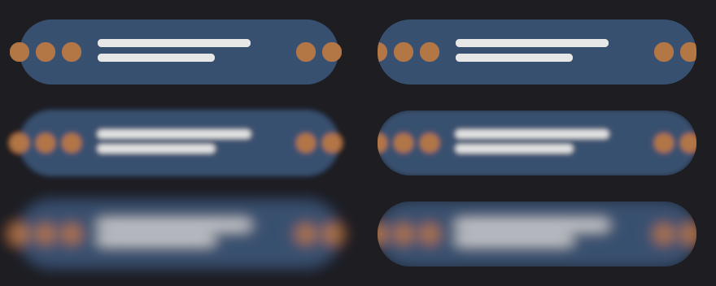

# Layer filters for Scrawl

The current Scrawl-height benchmark meets the added-GPU-cost target at Scrawl's default blur.
The budget is not met for every radius or larger surface. This note records the measured limits
and the rounded-clip integration work needed when the API lands.

Rows show sigma 0, 3 and 8 device pixels. The left column lets the filtered output extend beyond
the capsule; the right clips the completed layer to the capsule. This is a headless renderer
fixture, not a Scrawl application capture.

## Blur uses pooled Gaussian passes

`El::blur`, `live_blur` and `blur_motion` use `rune_motion::prop::BLUR`, including presence blur.
The runtime isolates the subtree and suppresses the old per-primitive blur. Ordinary target
changes follow the element's spring; Live samples do not rebuild the view or layout.

Sigma is in points at the element API and device pixels in `LayerSpec`. Device sigma is bounded
to 64; negative/NaN low-level values become zero. Bounds include three-sigma support and sources
outside the viewport. Completed scopes render inside out. Plus-lighter saturates source texels
before interpolation and convolution, rather than saturating the resulting halo.

For sigma ≤3 px, paired linear samples evaluate a separable discrete Gaussian in two passes.
Wider blurs add an exact-area prefilter and a linear reconstruction pass. The reduction factor
is `clamp(sigma / 3, 1, 8)`. Gaussian variance subtracts the prefilter/reconstruction variance.
The resolution change has no hard sigma-level switch. The tests check the 3 px boundary and
compare rectangle coverage against an independent full-resolution Gaussian through sigma 64:
maximum error was 2/255. This is a coverage fixture result, not a universal image-error bound.

Normal and additive input kernels, area prefilter and reconstruction use specialized pipelines.
The shader removes saturation and mode branches from the ordinary sampling loop. The two-pass
path needs one scratch texture; the reduced path needs two. Both follow the primary 64 px bucket
and retain storage while the layer fits. `LayerStats` includes scratch bytes, passes and allocations.
At zero there are no filter resources or passes; pipeline objects may remain cached.

Rune-fx's frost (`distort.wgsl:119`) is an eight-tap noisy spiral tied to lens distortion. It
cannot supply this deterministic subtree Gaussian. Its `MaskPyramid` was useful precedent for
pooled intermediates; no frost implementation was copied.

## Scrawl's default pill adds 0.129 ms on M4 Pro

Metal, M4 Pro mini, HiveMind, eight warmups and 60 samples. Each sample submits one frame and
waits for completion. Timestamp resolution happens afterwards. Figures include the full frame;
added cost subtracts the same-size isolated crossfade at sigma zero. Shader compilation and CPU
planning are outside the GPU timestamps. Other HiveMind tenants were active.

The local Scrawl source (`scrawl-swiftpill/src/native/pill/model.rs`) specifies a 40 pt island
height and default content sigma 1.5 pt. The fixture uses a 400 pt width, at 2×, in a 1024×512 px
destination. The earlier 400×120 pt fixture is a larger stress case, not Scrawl's capsule height.

| Size in points, 2× | Sigma in pixels | Frame median | Frame p95 | Added median |
|---|---:|---:|---:|---:|
| 400×40 | 0 | 0.099041 ms | 0.110500 ms | baseline |
| 400×40 | 3 | 0.228083 ms | 0.242834 ms | **0.129042 ms** |
| 400×40 | 8 | 0.275167 ms | 0.297250 ms | 0.176126 ms |
| 400×40 | 16 | 0.474750 ms | 0.504375 ms | 0.375709 ms |
| 400×120 | 0 | 0.155500 ms | 0.160125 ms | baseline |
| 400×120 | 3 | 0.373792 ms | 0.379709 ms | 0.218292 ms |
| 400×120 | 8 | 0.427125 ms | 0.636333 ms | 0.271625 ms |

The 400×120/sigma16 sample had inconsistent spans (0.216792 ms median, 0.622500 ms p95), so it
is not evidence of a budget win. The initial full-resolution 400×120/sigma8 implementation added
0.646667 ms. The reduced path lowers that cost, but wide blur still needs further work if Scrawl
raises its default sigma or requires the budget for its largest picker surfaces.

Run `cargo test -p rune --lib pill_blur_gpu_cost -- --ignored --nocapture --test-threads=1`
through HiveMind to reproduce. Timing is a manual benchmark rather than a hardware-dependent
unit-test assertion.

## Rounded masks belong to each completed scope

This branch implements `LayerSpec::clip_radius`, not a competing `El::mask_rounded` builder.
`Instance::begin_layer(bounds, clip, spec)` stores the radius in `radii[0]` and original clip edges
in `uv`; the instance remains 128 bytes. The final composite applies the rounded SDF and hard clip
after filtering. A masked scope materializes even at opacity one. The planner does not push a
parent's final clip into its children because that would lose source pixels before parent blur.

A coordination note was left in `desktop-fidelity/LAYER-FILTERS-HANDOFF.md`. His
`clip_rounded` implementation and Deadbolt's repack are absent from this base. A teammate should attach
the rounded clip to the appropriate completed scope, including blur at opacity one; distinct
nested rounded rectangles need distinct mask scopes. After repack, the agreed ordinary-instance
radius lane is `fade[3]`. Adapt marker extraction/composite construction at that integration point;
do not reinterpret the old layout's bottom-feather value as a radius. No confirmation or
high-level `clip_rounded` integration is claimed here.

## The alpha helper is the supported sRGB option

Use `theme::srgb_equivalent(c, bg)` for Scrawl's translucent neutral ink on a known opaque neutral
background. It preserves RGB and solves alpha in linear space. Animate the authored alpha, then
solve each sample; fading an already-solved alpha is not equivalent. Do not use it to claim exact
chromatic, translucent-backdrop, HDR, overlapping-paint or group-opacity composition.

`scripts/layer-srgb-reference.swift` renders through AppKit into an explicit sRGB bitmap without
opening a window. The ignored `appkit_srgb_fidelity_and_cost` GPU test compares the helper and an
experimental layer compositor against those bytes. The experimental shader samples independent
foreground/backdrop textures, unpremultiplies, encodes sRGB, blends, and decodes to the output.

| Fixture | Helper max byte error | Experimental composite max byte error |
|---|---:|---:|
| White 6% over dark grey | 0 | 0 |
| White 20% over dark grey | 0 | 0 |
| White 50% over black | 1 | 1 |
| Black 20% over light grey | 1 | 0 |
| Grey 35% over dark grey | 0 | 1 |
| White over blue | 18 | 0 |
| Orange over blue | 45 | 1 |
| Cyan over red | 49 | 1 |

For eight colour strips across 400×40 pt at 2×, the helper's full-frame median/p95 was
**0.078291/0.085500 ms**. The experimental three-pass frame was **0.102084/0.115042 ms**,
adding 0.023793 ms median and two 800×80 `Rgba16Float` textures (1,024,000 bytes). This is a
lower bound for a general compositor: it draws the backdrop into a separate texture and does
not include a snapshot of an existing framebuffer or arbitrary painter-order pass splitting.

The helper is the supported choice because Scrawl's neutral, known-backdrop case matches AppKit
without compositor dependencies. A general `Blend::Srgb` could improve chromatic fidelity but
needs destination snapshots and scope rules. The experiment remains test-only.

To reproduce, run Swift through HiveMind, save stdout to a temporary JSON file outside the
synced checkout, and set `RUNE_SRGB_REFERENCE` to that file for
`cargo test -p rune --lib appkit_srgb_fidelity_and_cost -- --ignored --nocapture --test-threads=1`.

## Verification

All commands ran serially through HiveMind on mini. Seventeen layer/filter correctness cases
passed, including the original ten layer cases, plus three Live tests. `cargo check -p rune
--all-targets` passed. GPU cases cover paired taps against a discrete oracle, negative origins,
zero/negative/NaN bypass, pooling, nested blur, post-filter capsule masks, additive saturation,
page-1 image sampling and newly published native video frames. Runtime cases cover curves,
smoothed/direct Live, replacement bindings, offscreen sources and presence completion.

The manual AppKit comparison, timing benchmark and single review still also ran successfully.
The presence test originally used `settle_all`, which did not complete its presence track in
this base; it now advances the transition clock to verify natural completion.
