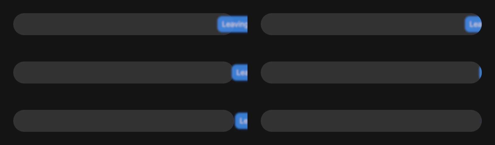
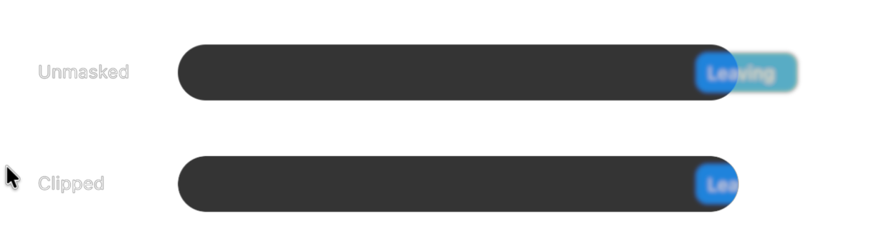
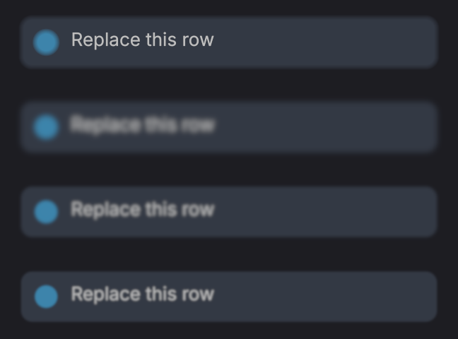

# Layer filters for Scrawl

Scrawl's default blur meets the measured added-GPU-cost target. Wider blurs and larger surfaces
can exceed it. This branch also implements `El::clip_rounded(radius)` and removes dissolve's
offscreen pass at rest. Deadbolt's packed-fade ABI is integrated, and a native overlay capture
verifies blur with rounded clipping on dev base `4223d64`.

Rows show sigma 0, 3 and 8 device pixels. The left column lets the filtered output extend beyond
the capsule; the right clips the completed layer to the capsule. This is a headless renderer
fixture, not a Scrawl application capture.

## Blur uses pooled Gaussian passes

`El::blur`, `live_blur` and `blur_motion` use `rune_motion::prop::BLUR`, including presence blur.
The runtime isolates the subtree and suppresses the old per-primitive blur. Ordinary target
changes follow the element's spring; Live samples do not rebuild the view or layout.

Sigma is in points at the element API and device pixels in `LayerSpec`. Device sigma is bounded
to 64; negative/NaN low-level values become zero. Bounds include three-sigma support and sources
outside the viewport. Completed scopes render inside out. Plus-lighter saturates source texels
before interpolation and convolution, rather than saturating the resulting halo.

For sigma ≤3 px, paired linear samples evaluate a separable discrete Gaussian in two passes.
Wider blurs add an exact-area prefilter and a linear reconstruction pass. The reduction factor
is `clamp(sigma / 3, 1, 8)`. Gaussian variance subtracts the prefilter/reconstruction variance.
The resolution change has no hard sigma-level switch. The tests check the 3 px boundary and
compare rectangle coverage against an independent full-resolution Gaussian through sigma 64:
maximum error was 2/255. This is a coverage fixture result, not a universal image-error bound.

Normal and additive input kernels, area prefilter and reconstruction use specialized pipelines.
The shader removes saturation and mode branches from the ordinary sampling loop. The two-pass
path needs one scratch texture; the reduced path needs two. Both follow the primary 64 px bucket
and retain storage while the layer fits. `LayerStats` includes scratch bytes, passes and allocations.
At zero there are no filter resources or passes; pipeline objects may remain cached.
Each layer caches its size, sigma and blend mode, so unchanged filters skip kernel generation
and uniform uploads while continuing to redraw live content.

Rune-fx's frost (`distort.wgsl:119`) is an eight-tap noisy spiral tied to lens distortion. It
cannot supply this deterministic subtree Gaussian. Its `MaskPyramid` was useful precedent for
pooled intermediates; no frost implementation was copied.

## Scrawl's default pill adds 0.129 ms on M4 Pro

Metal, M4 Pro mini, HiveMind, eight warmups and 60 samples. Each sample submits one frame and
waits for completion. Timestamp resolution happens afterwards. Figures include the full frame;
added cost subtracts the same-size isolated crossfade at sigma zero. Shader compilation and CPU
planning are outside the GPU timestamps. Other HiveMind tenants were active.

The local Scrawl source (`scrawl-swiftpill/src/native/pill/model.rs`) specifies a 40 pt island
height and default content sigma 1.5 pt. The fixture uses a 400 pt width, at 2×, in a 1024×512 px
destination. The earlier 400×120 pt fixture is a larger stress case, not Scrawl's capsule height.

| Size in points, 2× | Sigma in pixels | Frame median | Frame p95 | Added median |
|---|---:|---:|---:|---:|
| 400×40 | 0 | 0.099041 ms | 0.110500 ms | baseline |
| 400×40 | 3 | 0.228083 ms | 0.242834 ms | **0.129042 ms** |
| 400×40 | 8 | 0.275167 ms | 0.297250 ms | 0.176126 ms |
| 400×40 | 16 | 0.474750 ms | 0.504375 ms | 0.375709 ms |
| 400×120 | 0 | 0.155500 ms | 0.160125 ms | baseline |
| 400×120 | 3 | 0.373792 ms | 0.379709 ms | 0.218292 ms |
| 400×120 | 8 | 0.427125 ms | 0.636333 ms | 0.271625 ms |

The 400×120/sigma16 sample had inconsistent spans (0.216792 ms median, 0.622500 ms p95), so it
is not evidence of a budget win. The initial full-resolution 400×120/sigma8 implementation added
0.646667 ms. The reduced path lowers that cost, but wide blur still needs further work if Scrawl
raises its default sigma or requires the budget for its largest picker surfaces.

Run `cargo test -p rune --lib pill_blur_gpu_cost -- --ignored --nocapture --test-threads=1`
through HiveMind to reproduce. Timing is a manual benchmark rather than a hardware-dependent
unit-test assertion.

## Rounded masks belong to each completed scope

`El::clip_rounded(radius)` clips the element's own paint and its descendants to its presented
rectangle. Radius is in points, scales with the element, and clamps to half its shorter edge.
Ordinary subtrees apply the inherited rounded rectangle per primitive, without an offscreen
pass. Opacity, active dissolve and blur scopes apply the mask to their final composite instead.
Their source primitives remain unmasked so a chip beyond the wall can still contribute blur
inside it. Hit tests remain rectangular, including visually clipped corner areas; inspection
bounds retain the logical rectangular clip when painting consumes it.

`Instance::begin_layer(bounds, clip, spec)` stores radius bits in packed `fade[3]` and edges
in `clip`; the instance remains 128 bytes. The final composite applies the rounded SDF and hard clip
after filtering. A rounded masked scope materializes even at opacity one. Child textures are
bounded by the ancestor clip expanded by all intervening filter support; the actual rounded
clip stays separate, so bounds pruning cannot move corners or lose blur source pixels.

Nested rounded rectangles retain both sets of corner centres. A second distinct rounded clip
consumes the inherited mask on an outer scope; the inner mask stays direct or joins the inner
filter scope. A rectangular clip cutting through a rounded corner uses a separate outer scope.
Each mask keeps its original rectangle rather than rounding the intersected bounding box.
Packed feather widths and origin offsets survive onto the composite. These exceptional
intersections cost a layer; a single capsule with ordinary children does not. A rectangular
intersection that misses every radius-sized corner square needs no rounded coverage and stays
direct, including central scroll viewports. A single unmasked primitive or video under an
unfiltered rectangular opacity scope inherits its clip/fade and folds back to a direct draw.

Ordinary primitives, composites and native video all decode radius from `fade[3]`. The temporary
per-kind encoding, `radii[0]`/`uv` layer markers, `Layer::mask` and `SurfaceDraw::clip_radius` are
removed. Glyph gamma, shape geometry and atlas UVs retain their own lanes. Live/truncated text
and single-line inputs consume the rounded mask before adding a glyph-only rectangular clip.

Left: unmasked. Right: `clip_rounded(20)`. Three horizontal offsets in a 400×40 pt capsule at 2×,
with sigma 1.5 pt and opacity .65. The last source is fully beyond the wall; its inward halo
survives while exterior pixels are zero. This is a Rune headless fixture for Scrawl's case,
not a capture of the Scrawl application. The test compares every alpha byte against unmasked
blur multiplied by an independent capsule oracle (maximum allowed difference: one byte).

### Packed-fade integration is complete

The branch was rebased after both Deadbolt batches landed, then onto dev `4223d64` with its
overlay poll/compositor hooks and prewarm guards. The 128-byte ABI keeps half-float feather
widths in words 0–1, normalized origin offsets in word 2, and clip-radius bits in word 3.
The updated fade regression checks inherited nonzero offsets on composites at 1×/2×, with
rounded and rectangular masks. The combined LiveText/truncation regression compares alpha
against an independent capsule oracle through short and long live updates at both scales.

`ElementInfo.blur` is the additive culling margin in logical points: the sum of scaled node
and ancestor sigmas. Three times it bounds source support. It is not the equivalent Gaussian
sigma of sequential convolutions (which would combine variances).

### A real overlay contains the blurred chip

This is a Cua exact-window capture of a Rune NSPanel on Pro, built and run through HiveMind.
Both rows use a 400×40 pt capsule at 2×, nested dissolve/blur, sigma 1.5 pt and opacity .65.
The lower row clips the completed blur at the capsule edge. The fixture uses Scrawl's dimensions;
it is not a capture of Scrawl itself.

This 1240×352 capture was made on base `4223d64` after alpha-zero prewarming and a positive
Metal presentation, without diagnostic redraw assistance. The app and Cua session exited,
and the injected probe dylib was removed. Per-run JSON/log files are scratch, not tracked evidence.
Reproduction is in `examples/overlay-lab/README.md` under “Native layer-filter proof”.

## Dissolve is direct at rest

`dissolve()` activates only while a direct child's presented opacity is strictly between zero
and one. A linear prepass uses retained exits, presence, Live opacity, hover-group opacity and
opacity-loop/sequence samples. A flag cached when the tree rebuilds skips this pass entirely
when there are no PlusLighter nodes. Both parent additive blend and child isolation use the decision.
Scratch capacity is reused across frames. Returning to endpoints removes the dissolve scope;
starting a fade reinstates it on that frame.

At rest, overlapping opaque children use normal source-over composition, not additive saturation.
This deliberate semantic change suits mutually replacing states; a permanent additive scene
should use explicit low-level `Blend::PlusLighter` scopes. Blur or independent group opacity can
still require their own layer. The GPU test checks zero scopes/passes at endpoints, isolation
mid-fade, and byte-identical full frames at `0 → .00001` and `.99999 → 1`.

## `blur_replace` now peaks at sigma 1.5 pt

The pre-filter implementation's “4 pt radius” was a linear SDF coverage ramp on rectangles,
plus extra analytic shadow softness. It did not blur text, vector glyphs, images or video.
Keeping the numeric value as Gaussian sigma 4 changes the look substantially: text loses
legibility and shape edges become wider. There is no scalar conversion that reproduces the
old treatment of all paint types.

At 50% opacity, top to bottom: reconstructed legacy radius 4 pt; Gaussian peak sigma 4 pt;
variance-equivalent peak sigma `4 / sqrt(3)` ≈2.31 pt; chosen peak sigma **1.5 pt**. The screenshot
uses the same scale/opacity progress for every row. It confirms that the capped preset retains
more text detail, but does not claim byte-identical legacy appearance. Shape edges are sharper
than the old ramp, while text now softens with the whole state as intended.

The 2.31 pt candidate matches the variance of the old uniform edge kernel, but still enters
the four-pass path early in a 2× transition and cannot preserve formerly sharp glyphs. The
chosen preset caps sigma at 1.5 pt, hence ≤3 device pixels at 1×/2×, keeping two filter passes.
Scale .96, fade, spring timings, lifecycle and explicit `Transition::blur(sigma)` are unchanged.
Higher display scales or additional explicitly authored blur can still require four passes.

The comparison benchmark renders 300×36 pt rows at 2×, with a fill, circle and real glyph atlas
text. It samples presence opacity 0.25/0.5/0.75 and the corresponding scale/blur progress, for
one row and twelve simultaneously transitioning rows. Eight warmups, 60 completed samples,
M4 Pro/Metal through HiveMind. Variant order rotates each sample; added cost is the median of
paired differences from the reconstructed legacy frame. Each variant has fresh pooled storage.

| Rows | Opacity | Legacy frame | Sigma-4 frame | Capped frame | Sigma-4 added/row | Capped added/row |
|---:|---:|---:|---:|---:|---:|---:|
| 1 | .25 | 0.107125 ms | 0.219750 ms | 0.169083 ms | 0.112625 ms | 0.061917 ms |
| 1 | .50 | 0.103292 ms | 0.238833 ms | 0.157750 ms | 0.135625 ms | 0.054416 ms |
| 1 | .75 | 0.100833 ms | 0.159417 ms | 0.146292 ms | 0.058708 ms | 0.045417 ms |
| 12 | .25 | 0.765500 ms | 1.953792 ms | 1.293208 ms | 0.098660 ms | 0.043927 ms |
| 12 | .50 | 0.740291 ms | 1.915250 ms | 1.190667 ms | 0.097990 ms | 0.037490 ms |
| 12 | .75 | 0.717791 ms | 1.216625 ms | 1.136375 ms | 0.041795 ms | 0.035004 ms |

At half presence the twelve-row frame p95 improves from **2.079708 to 1.230416 ms**. The
variance-equivalent candidate was 1.901125 ms at .25 and 1.310000 ms at .50; the capped preset
was 1.293208/1.190667 ms. Four-pass sigma 4 consumes about **1.18 ms extra per twelve-row frame**
early/mid-transition, versus **0.45–0.53 ms** capped. It does not alone exhaust a 120 Hz frame,
but consumes roughly 14% of that budget before the rest of the app. The cap preserves headroom
and better matches the old text clarity. The 0.15 ms target is satisfied per row here, not for
the aggregate list. Filter passes drop from 48 to 24 for twelve rows at .25/.50; total extra
passes including isolation drop from 60 to 36, and pooled bytes from 23,592,960 to 15,728,640.

An initial sequential measurement overlapped another render job and produced p95 spans up to
13.55 ms and even negative variant deltas. Those numbers were rejected as contention, not used
to justify the cap. The table is from the interleaved rerun with much tighter p95 spans.
Reproduce with `cargo test -p rune --lib blur_replace_cost_and_appearance -- --ignored
--nocapture --test-threads=1` through HiveMind; optionally set `RUNE_TRANSITION_PROOF` to a PNG path.
The existing 11 `rune-motion` scene tests, Rune's exit/revive runtime test and the `curves`
example typecheck passed after the cap. These cover exact rest, initial mount, removal timing,
mid-flight revival and reduced motion. No renderer or runtime production file changed in this
follow-up.

## The alpha helper is the supported sRGB option

Use `theme::srgb_equivalent(c, bg)` for Scrawl's translucent neutral ink on a known opaque neutral
background. It preserves RGB and solves alpha in linear space. Animate the authored alpha, then
solve each sample; fading an already-solved alpha is not equivalent. Do not use it to claim exact
chromatic, translucent-backdrop, HDR, overlapping-paint or group-opacity composition.

## Verification

The review-fix pass has 29 layer/filter correctness tests. They cover zero-target clipped leaf
fades (primitive/video), central scroll clipping, single-line input masks, bounded nested targets,
uniform-cache invalidation, LiveText/truncation, all eight primitive kinds, retained exits and
off-wall blur. Dissolve tests check endpoint scope removal and byte-identical fade boundaries.
Native video's mirror flag stays in `sampling.w`, independent of the `fade[3]` radius.

Run `cargo test -p rune --lib render::layers -- --test-threads=1` through HiveMind. The two
ignored tests are the pill and blur-replace benchmarks documented above. Set `RUNE_CLIP_STILL`
when running `rounded_clip_blurred_exiting_chip_stays_inside_capsule` to regenerate that sheet.
GPU timings in this document are historical pre-repack measurements, not new timing runs.
